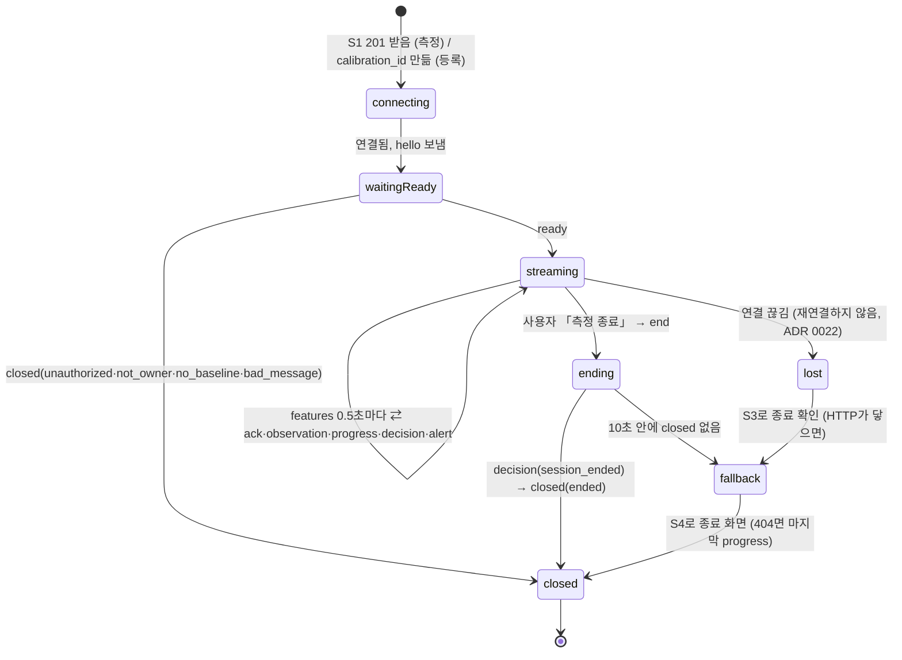
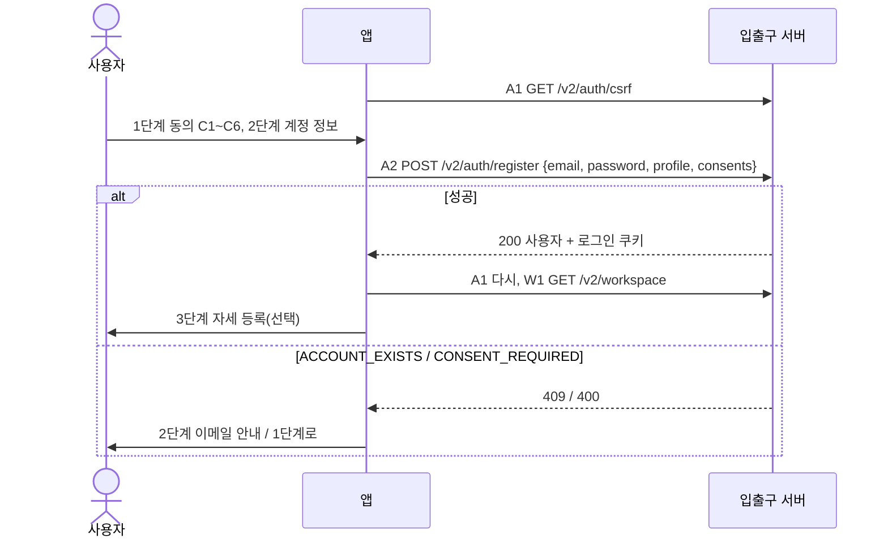
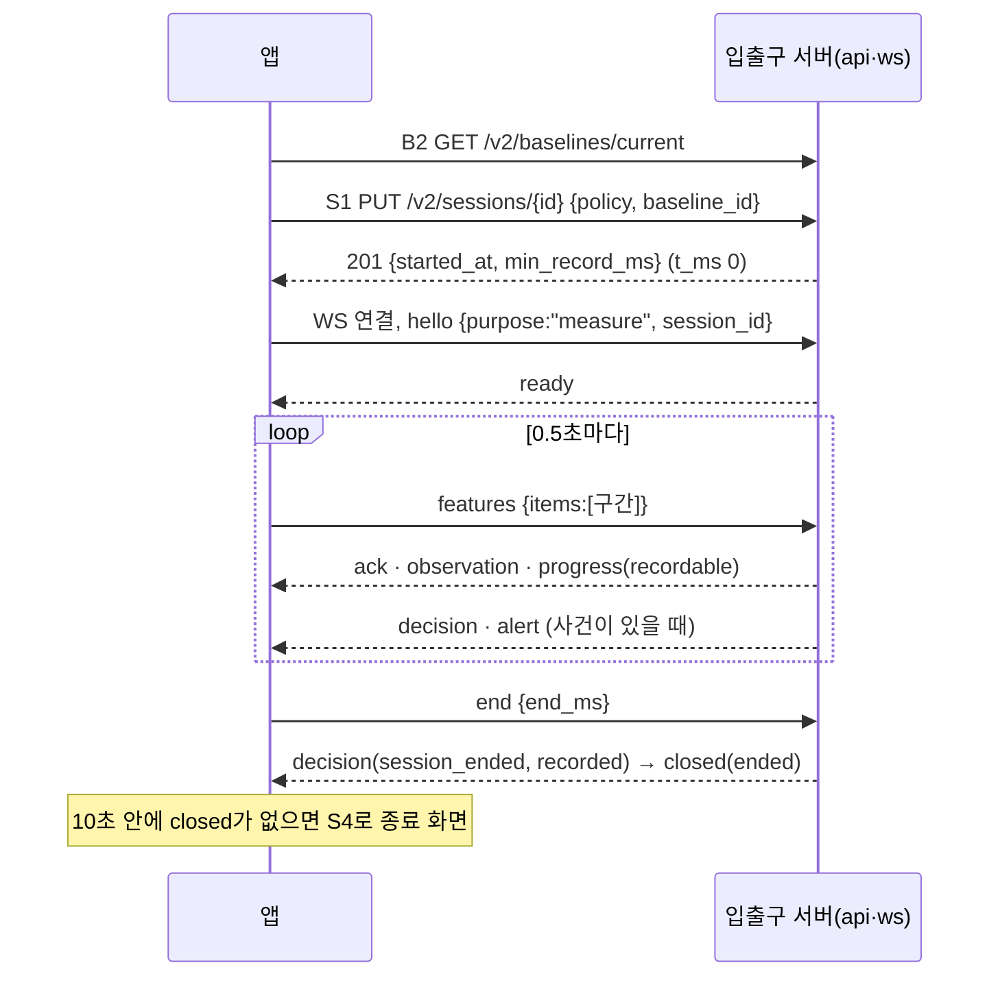
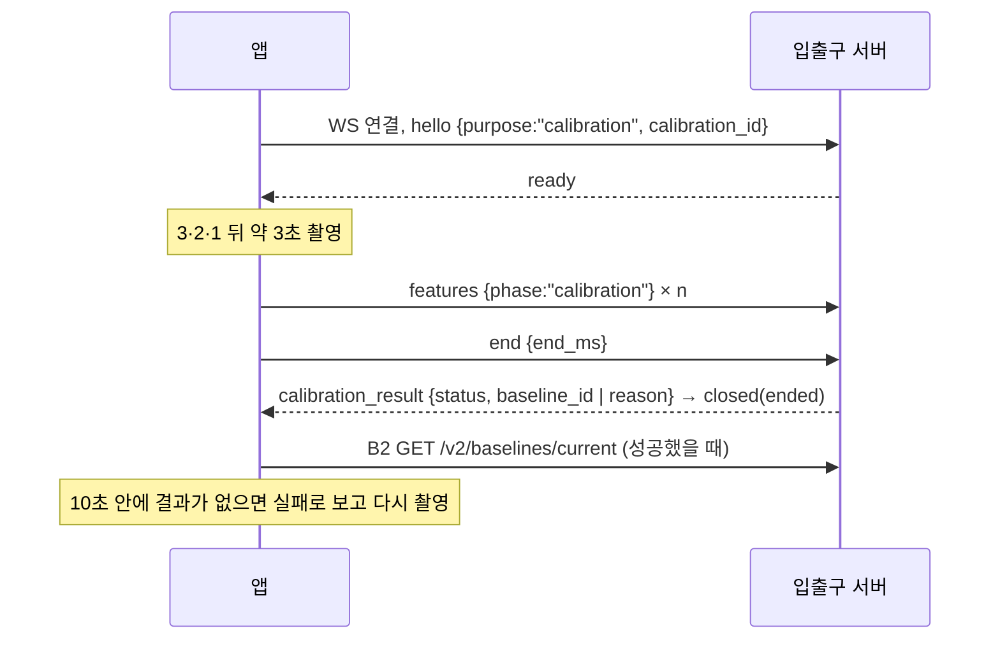
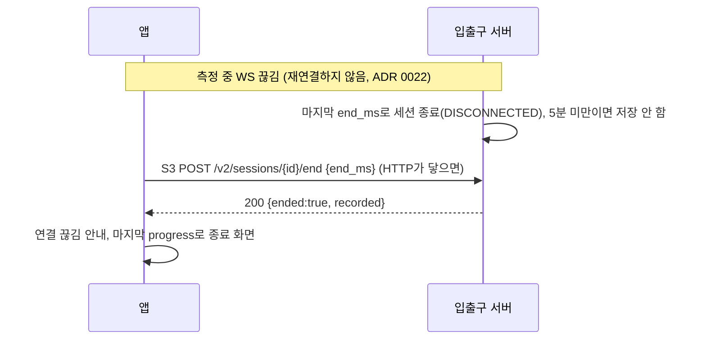

# 앱 ↔ 입출구 서버 연동 명세 (FE)

> 작성: 2026-10-13 · FE · 상태: **초안** · 대상: BE(입출구 서버 `auth`·`api`·`ws`), DevOps
> 짝 문서: BE 「FE ↔ BE API 명세 (입출구 서버)」(홍규 10/13, 목표 설계)와 `api-spec.html`(`feature/repo-backend-db-v2` `ce57f56`, 지금 코드). **엔드포인트 ID(A1, S1 …)와 경로는 BE 문서를 그대로 쓴다.**
> 근거: [FE 제안서](fe-server-proposal.md), [동의 제안서](consent-proposal.md), 아키텍처 v5.1, [ADR 0021](../decisions/0021-app-sends-information-server-judges.md)·[ADR 0022](../decisions/0022-session-ends-on-lost-connection.md)(끊기면 세션 종료), DB V2.3

BE 문서는 서버가 무엇을 주는지를 적는다. 이 문서는 **앱이 언제 무엇을 부르고, 결과마다 화면이 어떻게 움직이는지**를 적는다.
나눔: **로그인·설정·기준 조회·기록·통계는 REST, 실시간 판정과 자세 등록은 WebSocket.**

## 1. 공통 규칙

BE 문서의 공통 규칙을 그대로 따른다. 앱 쪽에서 지킬 것만 덧붙였다.

| 항목 | 규칙 | 앱이 하는 일 |
|---|---|---|
| 주소 | 앱은 `/api/v2/…`, WS는 `/api/v2/realtime`. 중계(nginx·Vite)가 `/api`를 뗀다 | 경로는 `features/platform/serverConfig.ts` 한 곳에서 만든다 |
| 로그인 | HttpOnly·SameSite=Lax 쿠키(`SPRING_SESSION`), 만료 30분. WS도 같은 쿠키 | 쿠키를 직접 읽지 않는다. 401이면 로그인 화면 |
| CSRF | `GET /v2/auth/csrf`(A1) 토큰을 POST·PUT·DELETE의 `X-CSRF-TOKEN`에. 가입·로그인 포함 | 앱 시작·로그인·로그아웃 뒤 다시 받는다. 403 `ACCESS_DENIED`면 한 번만 다시 받아 재시도 |
| 계정 헤더 | 보호 요청에 `X-PoseGood-User-Id: <user_id>` | A4(`me`)나 로그인 응답의 `user_id`를 넣는다. 409 `AUTH_CHANGED`면 계정 정보를 다시 받는다 |
| 본문 | JSON snake_case. 모르는 필드는 400. `/v2/workspace`의 `rules`·기록만 camelCase | 보낼 때 앱 타입에서 그대로 만들고 남는 필드를 넣지 않는다 |
| 오류 | `{error, code, message}`. 앱은 HTTP 상태가 아니라 `code`로 나눈다 | 2장 표 |
| 시각 | 응답은 UTC ISO-8601. 측정 안 시간은 세션 시작 기준 ms(`t_ms`·`start_ms`·`end_ms`) | 화면에 보일 때만 KST로 바꾼다 |
| 세션 시작 | `started_at` = 서버가 `PUT /v2/sessions/{id}`(S1)를 받은 시각 = 앱 `t_ms` 0 (10/13 결정) | S1 201을 받은 순간부터 `t_ms`를 센다 |
| ID | `session_id`·`calibration_id`는 앱이 만드는 UUID, `baseline_id`는 서버 UUID, `user_id`는 10진 문자열 | 재시도 때 같은 UUID를 쓴다 |
| 시간 기본값 | 판정 3·3·60초, `min_record_ms` 300000은 서버 설정 | 앱은 받은 값만 쓴다(코드에 넣지 않음) |
| 재시도 | 502·503(`…_BUSY`·`STORAGE_UNAVAILABLE`·`INFERENCE_FAILED`)은 같은 본문 그대로 | 최대 3번, 1·2·4초 간격. 그래도 안 되면 오류 안내 |

## 2. 오류 코드별 앱 동작

BE `api-spec.html`의 오류 표에 앱 쪽 동작을 채운 것이다.

| HTTP | code | 뜻 | 앱 화면·동작 |
|---|---|---|---|
| 400 | `INVALID_CONTRACT` | 형식·범위 위반 | 개발 단계 버그. "요청을 보내지 못했어요" + 콘솔 기록 |
| 400 | `INVALID_PASSWORD` | 비밀번호 규칙 위반, 현재 비밀번호 불일치 | 비밀번호 칸 아래 안내 |
| 400 | `CONSENT_REQUIRED` | 필수 동의 누락·버전 다름, 동의 없이 나이·직업 | 가입 1단계(약관 동의)로 돌아간다 |
| 401 | `UNAUTHENTICATED` | 로그인 없음·만료 | 로그인 화면. 측정 중이면 그 세션은 서버가 끝낸다 |
| 401 | `INVALID_CREDENTIALS` | 이메일·비밀번호 불일치 | "이메일이나 비밀번호가 맞지 않아요" |
| 403 | `ACCESS_DENIED` | CSRF 실패 | 토큰을 다시 받아 한 번 재시도, 또 실패하면 새로고침 안내 |
| 403 | `ACCOUNT_CLOSED` | 탈퇴 유예 중 로그인 | 탈퇴 철회(A8) 안내 |
| 404 | `SESSION_NOT_FOUND`·`SESSION_LOST` | 세션 없음, 서버가 상태를 잃음 | 측정을 끝내고 마지막 `progress`로 종료 화면 |
| 404 | `BASELINE_NOT_FOUND` | 기준 자세 없음 | 측정하기에서 3초 등록을 먼저 한다 |
| 409 | `AUTH_CHANGED` | 다른 탭에서 계정이 바뀜 | A4로 계정을 다시 받고 화면을 새로 그린다 |
| 409 | `ACCOUNT_EXISTS` | 이미 쓰는 이메일 | 가입 2단계 이메일 칸 아래 안내 |
| 409 | `BASELINE_REQUIRED` | 기준 없이 세션 생성 | 측정하기 등록 흐름으로 |
| 409 | `CONFLICT` | 재시도 본문 불일치, 설정·기준이 바뀜 | W1·B2를 다시 받고 사용자가 다시 시작 |
| 409 | `SESSION_ENDED` | 끝난 세션 | 종료 화면 |
| 409 | `WITHDRAWAL_NOT_CANCELLABLE` | 유예 만료 | 안내만 |
| 429 | `LIMIT_REACHED` | 세션 한도 초과 | 측정을 끝내고 새로 시작 안내 |
| 502·503 | `INFERENCE_FAILED`·`STORAGE_UNAVAILABLE`·`ACCOUNT_BUSY`·`SESSION_BUSY` | 일시 장애 | 1장 재시도 규칙 |

## 3. 엔드포인트 목록

상태: **연결** = 앱이 지금 부른다 · **할 일** = 앱 코드가 없다.
2026-10-13 계정 모드를 지워 지금 앱은 로컬 로그인이다. 아래 REST는 서버가 생기면 다시 붙인다.

| ID | 메서드·경로 | 부르는 화면·시점 | 앱 상태 |
|---|---|---|---|
| A1 | `GET /v2/auth/csrf` | 앱 시작, 로그인·로그아웃 뒤 | 할 일 |
| A2 | `POST /v2/auth/register` | 회원가입 2단계 「다음」 | 할 일(지금은 이 기기에 저장) |
| A3 | `POST /v2/auth/login` | 로그인 「로그인」 | 할 일(지금은 입력값 확인 없음) |
| A4 | `GET /v2/auth/me` | 앱 시작(로그인 유지 확인) | 할 일 |
| A5 | `POST /v2/auth/logout` | 계정 메뉴 「로그아웃」 | 할 일 |
| A6 | `PUT /v2/auth/password` | 설정 › 비밀번호 변경 | 할 일 |
| A7 | `DELETE /v2/auth/account` | 프로필 › 탈퇴 | 할 일 |
| A8 | `POST /v2/auth/withdrawal/cancel` | 로그인에서 `ACCOUNT_CLOSED`를 받았을 때 | 할 일 |
| C1 | `PUT /v2/consents/optional-profile` | 프로필 › 선택 정보 동의 켜기·끄기 | 할 일 |
| W1 | `GET /v2/workspace` | 로그인 직후 한 번 | 할 일 |
| W2 | `PUT /v2/workspace` | 설정·프로필 저장 | 할 일 |
| B2 | `GET /v2/baselines/current` | 측정하기 열 때, 등록 뒤 | 할 일(지금은 이 PC에 저장, `savedBaseline.ts`) |
| B1 | `POST /v2/baselines` | 전환 기간에만(앱 계산 등록). WS 등록이 되면 없앰 | 쓰지 않음 |
| S1 | `PUT /v2/sessions/{id}` | 측정 시작 | 연결(v1 형식) |
| S3 | `POST /v2/sessions/{id}/end` | WS가 이미 끊겼을 때만 | 연결(v1 형식) |
| S4 | `GET /v2/sessions/{id}` | 종료 뒤 10초 안에 `closed`가 없을 때 | 연결 |
| S5 | `GET /v2/sessions/{id}/metadata` | 기록 상세(개발자용) | 연결 |
| R1 | `GET /v2/records` | 기록 화면 | 할 일 |
| R1b | `GET /v2/records/{id}` | 종료 화면 대비책 | 할 일 |
| R3 | `DELETE /v2/records/{id}` | 기록 삭제 | 할 일 |
| T1 | `GET /v2/stats/daily?from&to` | 기록 화면의 지난 날짜 | 할 일 |
| WS | `/v2/realtime` | 측정(`measure`), 자세 등록(`calibration`) | 할 일(v1 `/v1/realtime`은 개발용으로 연결) |
| — | `POST /v2/sessions/{id}/features`, `POST /v2/records` | 없앰(BE 문서) | 쓰지 않게 바꾼다 |

## 4. REST

### 4.1 가입·로그인 (A1~A8)

- **A2 가입:** 회원가입 2단계 「다음」에서 보낸다. 본문 `{email, password, profile, consents}`.
  - `profile` = `{name, age, occupation}`. 선택 정보(C3)에 비동의면 `age`·`occupation`은 `null`.
  - `consents` = 동의한 항목만 `[{type, document_version:"service-v2"}]`. 필수 5종(`AGE_14_OVER`·`TERMS`·`ACCOUNT_INFO`·`POSE_COORDINATES`·`MEASUREMENT_RECORD`)은 항상, `OPTIONAL_PROFILE`은 동의했을 때만. 앱 코드는 `features/auth/consents.ts`의 `consentPayload()`.
  - 비밀번호: 명세는 12자 이상(UTF-8 72바이트 이하). **지금 앱은 시험 편의로 최소 길이를 보류**하고 비어 있지 않은지만 본다. 서버를 붙일 때 12자로 되돌린다.
  - 200이면 로그인된 상태다. A1로 토큰을 다시 받고 W1 → 회원가입 3단계(자세 등록, 선택).
- **A3 로그인:** 200이면 A1 → W1 → 측정하기. 화면 인사("○○님, 다시 오셨네요")는 로그인 뒤에만.
- **A4 앱 시작:** 쿠키가 살아 있으면 로그인 화면을 건너뛴다. 401이면 로그인 화면.
- **A5·A6·A7:** 측정 중이면 서버가 WS를 `closed(unauthorized)`로 닫는다. 앱은 측정 화면을 닫고 로그인 화면으로.

### 4.2 동의·설정·기준 (C1, W1, W2, B2)

- **W1:** `{schema_version, profile, rules, preferences, consents, records}`를 한 번에 받는다.
  - `rules`는 판정 기준(기본 3·3·60·0.7), `preferences.alerts_on`은 「자세 알림」(DB `sound_alert_enabled`).
  - `records`는 R1과 같다. 앱은 R1을 따로 부르지 않고 이것을 먼저 쓴다.
- **W2:** 설정·프로필 저장 때 `{profile, rules, preferences}` 세 개를 모두 보낸다. 다음 측정부터 적용.
- **C1:** 선택 정보 동의를 끄면 서버가 나이·직업을 비운다. 앱은 응답(W1 형식)으로 화면을 다시 그린다.
- **B2:** 측정하기를 열 때 부른다. 200이면 「측정 시작」, 404면 3초 등록부터. 등록(WS calibration) 뒤 다시 부른다.

### 4.3 측정 세션 (S1, S3, S4)

- **S1 시작:** 본문 `{policy, baseline_id}`. `policy`는 W1의 `rules`를 ms로 바꾼 값, `baseline_id`는 B2 값.
  - 201 응답 `{session_id, started_at, policy, baseline_id, alert_enabled, min_record_ms}`. 이 순간이 `t_ms` 0이다.
  - 같은 UUID·같은 본문 재시도는 같은 세션(200). 409 `CONFLICT`면 W1·B2를 다시 받고 사용자가 다시 시작.
- **S3 끊긴 뒤 종료:** WS가 이미 닫혔고 HTTP는 닿을 때만 `{end_ms}`. 응답 `{session_id, ended, recorded}`.
- **S4 종료 화면 대비책:** `end` 뒤 10초 안에 `closed`가 없으면 부른다. 5분 미만 세션은 404 → 마지막 `progress`로 그리고 "5분 미만 측정은 기록에 남지 않아요".

### 4.4 기록·통계 (R1, R1b, R3, T1) — BE 다음 주 범위

- **R1·R1b:** `RecordItem`(지금 앱 형식, camelCase). 5분 미만 세션은 없다.
- **R3:** 기록 삭제. HDFS 파일이 있는 세션은 409 → "지금은 지울 수 없어요".
- **T1:** `[{date, session_count, valid_sec, good_sec, event_count, alerted_event_count, min_until_collapse_sec, max_until_collapse_sec}]`. 화면의 최소·최대 간격은 `min_`·`max_until_collapse_sec`. 오늘치는 J2(매일 00:00 전날 집계) 전이라 없다 → 화면 담당과 표시 방법을 정한다(8장).

## 5. WebSocket `/v2/realtime`

### 5.1 앱 상태

### 5.2 앱 → 서버

| `type` | 필드 | 보내는 때 |
|---|---|---|
| `hello` | `schema_version:"2.0"`, `purpose:"measure"\|"calibration"`, `session_id`(측정) 또는 `calibration_id`(등록) | 연결 직후 한 번. 측정은 S1 201 뒤 |
| `features` | `items`: 좌표 구간 1~30개(순번 순) | `ready` 뒤 0.5초마다 1개 |
| `end` | `end_ms` | 측정: 「측정 종료」. 등록: 3초 촬영이 끝났을 때 |

좌표 구간 `items[]` (`posture.frames.v1`, 앱 코드 `features/session/realtime/frames.ts`):

| 필드 | 값 |
|---|---|
| `schema_version` · `feature_version` | `"3.0"` · `"keypoints-9-v1"` |
| `sequence` | 세션 안 순번, 0부터 1씩 |
| `start_ms` · `end_ms` | 구간 `[start, end)`, 보통 500ms |
| `phase` | 측정 `running`·`rest`(일시정지)·`away`(카메라 끊김), 등록 `calibration` |
| `width` · `height` | 영상 크기. 640×480을 요청하고 실제로 받은 값을 넣는다(다르면 측정을 시작하지 않음, FE 제안서 F13) |
| `frames[]` | 0~30개, 평균 내지 않음. `rest`·`away`는 빈 배열 |
| `frames[].t_ms` · `frames[].p` | 프레임 시각, 관절 9개 `[x, y, visibility]`(사람이 없으면 `null`) |
| `frames[].valid` | `false`일 때만 넣는다. 귀·어깨·사용자가 안 보이는 등 측정이 안 되는 모든 경우(10/12 회의). 서버는 `unmeasurable`로 본다 |

### 5.3 서버 → 앱

| `type` | 받으면 앱이 하는 일 |
|---|---|
| `ready` | `features`를 보내기 시작. 측정이면 `min_record_ms`를 기억한다 |
| `ack` | 표시만(재전송하지 않음) |
| `observation` | 실시간 상태 알약과 안내 문구. 점수 = `100 × (1 − collapse_probability)`. `invalid_reason`: `unmeasurable` "자세를 확인할 수 없어요" · `head_turn` · `settling` |
| `progress` | 측정 시간·유지율 등 숫자. `recordable`이 `false`면 "기록까지 m:ss 남았어요". `paused_reason`(`unmeasurable`·`rest`·`away`)이면 측정 멈춤 표시 |
| `decision` | 사건 기록·숫자. `session_ended`의 `recorded:false`면 종료 화면에 "기록에 남지 않은 측정이에요" |
| `alert` | 토스트·소리. 앱은 따로 거르지 않는다(알림 끔·시간당 상한은 서버가 판단) |
| `stalled` | "분석이 잠시 멈췄어요" |
| `calibration_result` | 등록 성공이면 B2를 다시 받고 「앱 시작」·측정하기. 실패면 사유별 안내(아래) 후 다시 촬영 |
| `closed` | 아래 표 |

| `closed.reason` | 앱 |
|---|---|
| `ended` | 종료 화면(측정) / 등록 결과 화면(등록) |
| `unauthorized` | 로그인 화면 |
| `not_owner`·`bad_message` | 오류 안내. 개발 단계 버그로 기록 |
| `session_lost` | 마지막 `progress`로 종료 화면 |
| `no_baseline` | 측정하기 등록 흐름으로 |
| `server_shutdown` | 연결 끊김 안내(ADR 0022, 재연결하지 않음) |

`calibration_result.reason` 안내: `too_few_frames` "자세를 알아보기 어려워요. 얼굴과 어깨가 보이게 앉아 주세요" · `incomplete` "등록이 중간에 끊겼어요" · `out_of_frame` "화면 안쪽으로 앉아 주세요" · `server_error` "잠시 뒤 다시 해 주세요".

## 6. 흐름

### 6.1 가입·로그인

### 6.2 측정 한 번

### 6.3 자세 등록

### 6.4 끊김

## 7. 앱에서 아직 서버 전 상태로 둔 것

| 항목 | 지금 | 서버를 붙일 때 |
|---|---|---|
| 로그인 | 입력값을 확인하지 않고 이 기기에 가입한 프로필로 들어간다 | A1·A3·A4 |
| 가입 | 프로필·이메일·동의 선택을 이 기기에 저장, 비밀번호는 저장하지 않음 | A2(`consentPayload()`), 비밀번호 12자 검사 되돌리기 |
| 기준 자세 | 이 PC에 카메라별로 저장(`savedBaseline.ts`), 앱이 계산 | B2 조회 + WS calibration(서버 계산) |
| 실시간 | `/v1/realtime`(특징 변화량) 개발 연결, 좌표 묶음(`frames.ts`)은 준비만 | `/v2/realtime`으로 바꾸고 좌표 묶음을 기본으로 |
| 기록·통계 | 이 기기의 기록 | W1·R1·T1 |

## 8. 정할 것

| # | 정할 것 | FE 안 | BE 안 | 담당 |
|---|---|---|---|---|
| 1 | 5분을 무엇으로 세나 | 회의 뜻 확인 필요 | 측정 시간 `total_ms` | 사용자(회의) |
| 2 | 오늘 기록을 기록 화면에 어떻게 보이나(J2는 00:00에 전날만) | 오늘은 R1의 세션별 기록으로 보이고 합산은 하지 않는다(10/12 결정) | 앱이 오늘 기록을 합치거나 "어제까지" | 화면 담당·FE |
| 3 | 동의 문구 버전 | `service-v2`(BE 명세에 맞춤, 앱 반영함) | `service-v2` | 확정 |
| 4 | 비밀번호 최소 길이 | 명세 12자, 앱은 시험 동안 보류 | 12자 | 확정(앱 적용만 보류) |
| 5 | 세션 시작 시각 | BE 안 따름(10/13) | S1 받은 시각 | 확정 |
| 6 | 판정 불가 필드 | `frames[].valid:false` | 같음 | 확정 |
| 7 | 0.5초 관측 점수 방식(N3) | 마지막 판정 프레임 값 | 같음(설정값) | ML |
| 8 | `/v1/realtime` 정리 시점 | 앱이 v2로 바뀐 뒤 | 같음(D-38) | FE·BE |

다음 단계: 8장 1·2번이 정해지면 `contracts/realtime/`에 WS v2·좌표 구간·`calibration_result` JSON 스키마를 BE와 함께 옮긴다(contracts 최신화).
