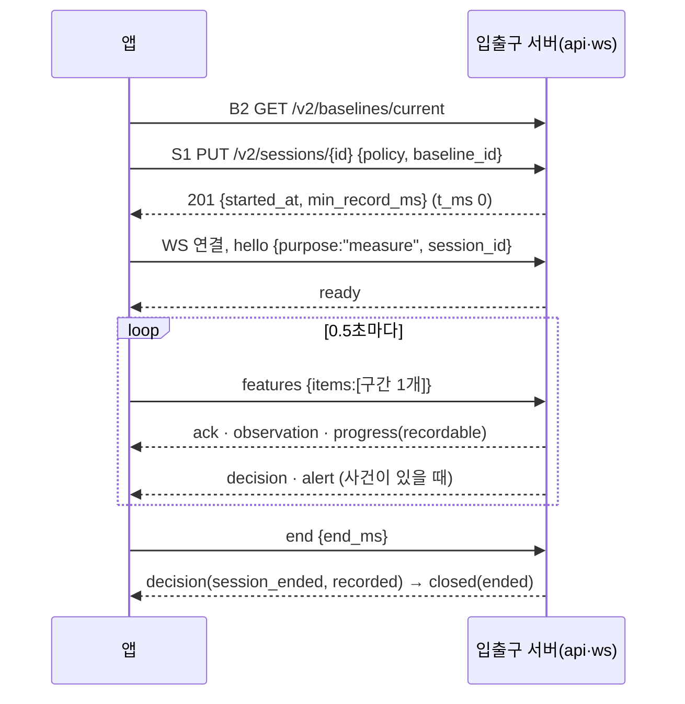
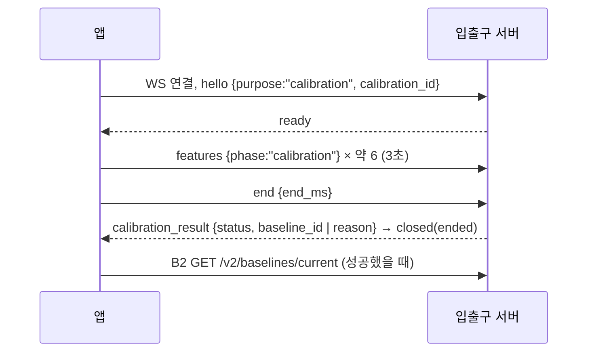

# 앱 ↔ 입출구 서버 연동 명세 (FE)

> 작성: 2026-10-13 · FE · 상태: **초안(BE 확인 요청)** · 대상: BE(입출구 서버 `auth`·`api`·`ws`), DevOps
> 짝 문서: BE 「FE ↔ BE API 명세 (입출구 서버)」(홍규, 10/13). **경로·엔드포인트 ID·메시지 이름은 BE 명세를 그대로 쓴다.** 지금 서버 코드 기준 명세는 `api-spec.html`(`feature/repo-backend-db-v2` `ce57f56`, DB V2.3).
> 근거 결정: 10/12 회의, 10/13 FE 결정, [ADR 0021](../decisions/0021-app-sends-information-server-judges.md)(앱은 판정하지 않음), [ADR 0022](../decisions/0022-session-ends-on-lost-connection.md)(끊기면 세션 종료, 재연결 없음)

## 0. BE가 먼저 볼 것

**한 줄 요약: 앱은 BE 명세(10/13)를 그대로 따른다.** 이 문서는 앱이 언제 무엇을 부르고 응답마다 어떻게 움직이는지를 적었고, BE에 확인·요청할 것은 아래 0.2 표가 전부다.

### 0.1 BE 명세의 「정할 것」에 대한 FE 답

| BE 명세 9장 # | 정할 것 | FE 답 |
|---|---|---|
| 2 | 5분을 무엇으로 세나 | **측정 시간 `total_ms`**(시작~종료, 일시정지 포함). 정확히 5분은 저장 |
| 3 | WS 새 경로 `/v2/realtime`, v1 유지 기간 | 동의. 앱이 v2로 바뀌면 v1은 없애도 된다 |
| 4 | 끊기면 세션 종료(ADR 0022) | 동의. 앱은 재연결하지 않는다 |
| 6 | 알림 표시·억제 판단 위치(N6) | 동의(저장 서비스 판단 → `ws`). 앱은 받은 `alert`를 거르지 않는다 |
| 9 | 등록 최소 프레임 | 동의(3초 안에 판정 가능 15장) |
| — | 세션 시작 시각 | **BE 안대로 S1을 받은 시각 = 앱 `t_ms` 0** |
| — | 판정 불가 필드 | **`frames[].valid: false`**(BE 명세 표기 그대로) |
| — | 오늘 기록 | 결과 화면에는 방금 끝난 세션만, 기록 화면에는 오늘을 보이지 않는다(앱이 거른다, 서버 변경 없음) |

### 0.2 BE에 확인·요청할 것

| # | 항목 | FE 안 | BE에 요청 |
|---|---|---|---|
| Q1 | `features` 한 메시지에 넣는 구간 수 | 앱은 **0.5초마다 구간 1개**만 보낸다. 구간 하나는 약 2~7KB(프레임 0~30장) | 지금 서버 WS 메시지 한도 64KB 안에 든다. 30개 묶음은 앱이 쓰지 않으니 한도를 그대로 두어도 되는지 확인 |
| Q2 | `ready`를 기다리는 시간 | 앱은 `hello` 뒤 **5초** 안에 `ready`가 없으면 연결을 닫고 "서버에 연결하지 못했어요"를 보인다 | 서버가 `hello`를 처리하는 데 5초 넘게 걸릴 수 있는지 확인 |
| Q3 | 비밀번호 12자 | 서버는 12자 그대로 둔다. 앱은 시험 편의로 지금 최소 길이를 보류했고, **서버를 붙일 때 12자 검사를 켠다** | 변경 없음(확인만) |
| Q4 | 5분 미만 세션 행 삭제 | BE A안(종료 때 `monitor_session` 삭제) 동의 | DB 담당 확인(BE 명세 9장 #5) |
| Q5 | 오류 `code`가 2장 표에 없는 경우 | 앱은 HTTP 상태로만 처리한다(4xx 안내, 5xx 재시도) | 새 `code`를 만들면 알려 주기 |

## 1. 공통 규칙

| 항목 | 규칙 (BE 명세와 같음) | 앱이 하는 일 |
|---|---|---|
| 주소 | 앱은 `/api/v2/…`, WS는 `/api/v2/realtime`. 중계(nginx·Vite)가 `/api`를 뗀다 | 개발 중에는 Vite가 `/api`를 입출구 서버로 넘긴다 |
| 로그인 | HttpOnly·SameSite=Lax 쿠키(`SPRING_SESSION`), 만료 30분. WS도 같은 쿠키 | 쿠키를 직접 다루지 않는다. 401이면 로그인 화면 |
| CSRF | `GET /v2/auth/csrf`(A1) 토큰을 POST·PUT·DELETE의 `X-CSRF-TOKEN`에. 가입·로그인 포함 | 앱 시작·로그인·로그아웃 뒤 다시 받는다. 403 `ACCESS_DENIED`면 한 번만 다시 받아 재시도 |
| 계정 헤더 | 보호 요청에 `X-PoseGood-User-Id: <user_id>` | 로그인·A4 응답의 `user_id`. 409 `AUTH_CHANGED`면 A4로 다시 받는다 |
| 본문 | JSON snake_case. 모르는 필드는 400. `/v2/workspace`의 `rules`와 기록만 camelCase | 명세에 없는 필드는 보내지 않는다 |
| 오류 | `{error, code, message}` | `code`로 나눈다(2장) |
| 시각 | 응답은 UTC ISO-8601. 측정 안 시간은 세션 시작 기준 ms | 화면에 보일 때만 KST로 바꾼다 |
| 세션 시작 | `started_at` = 서버가 S1을 받은 시각 = 앱 `t_ms` 0 | S1 201을 받은 순간부터 `t_ms`를 센다 |
| ID | `session_id`·`calibration_id`는 앱 UUID, `baseline_id`는 서버 UUID, `user_id`는 10진 문자열 | 재시도 때 같은 UUID |
| 시간 기본값 | 판정 3·3·60초, `min_record_ms` 300000은 서버 설정 | 앱은 받은 값만 쓴다 |

### 1.1 앱의 시간 규칙

| 상황 | 앱이 기다리는 시간 | 넘으면 |
|---|---|---|
| 502·503 재시도 | 1·2·4초 간격, 최대 3번 | 오류 안내 |
| `hello` → `ready` | 5초 (Q2) | 연결을 닫고 "서버에 연결하지 못했어요" |
| `features` 보내기 | 0.5초마다 구간 1개 (Q1). 일시정지·카메라 끊김 중에도 빈 구간을 계속 보낸다 | — |
| 측정 `end` → `closed(ended)` | 10초 | S4로 종료 화면(5분 미만이면 404 → 마지막 `progress`로) |
| 등록 `end` → `calibration_result` | 10초 | 실패로 보고 다시 촬영 |

## 2. 오류 코드별 앱 동작

| HTTP | code | 앱 화면·동작 |
|---|---|---|
| 400 | `INVALID_CONTRACT` | "요청을 보내지 못했어요". 앱 버그로 기록 |
| 400 | `INVALID_PASSWORD` | 비밀번호 칸 아래 안내 |
| 400 | `CONSENT_REQUIRED` | 가입 1단계(약관 동의)로 돌아간다 |
| 401 | `UNAUTHENTICATED` | 로그인 화면 |
| 401 | `INVALID_CREDENTIALS` | "이메일이나 비밀번호가 맞지 않아요" |
| 403 | `ACCESS_DENIED` | CSRF 토큰을 다시 받아 한 번 재시도, 또 실패하면 새로고침 안내 |
| 403 | `ACCOUNT_CLOSED` | 탈퇴 철회(A8) 안내 |
| 404 | `SESSION_NOT_FOUND`·`SESSION_LOST` | 측정을 끝내고 마지막 `progress`로 종료 화면 |
| 404 | `BASELINE_NOT_FOUND` | 측정하기에서 자세 등록부터 |
| 409 | `AUTH_CHANGED` | A4로 계정을 다시 받고 화면을 새로 그린다 |
| 409 | `ACCOUNT_EXISTS` | 가입 2단계 이메일 칸 아래 안내 |
| 409 | `BASELINE_REQUIRED` | 측정하기 자세 등록으로 |
| 409 | `CONFLICT` | W1·B2를 다시 받고 사용자가 다시 시작 |
| 409 | `SESSION_ENDED` | 종료 화면 |
| 409 | `WITHDRAWAL_NOT_CANCELLABLE` | 안내만 |
| 429 | `LIMIT_REACHED` | 측정을 끝내고 새로 시작 안내 |
| 502·503 | `INFERENCE_FAILED`·`STORAGE_UNAVAILABLE`·`ACCOUNT_BUSY`·`SESSION_BUSY` | 1.1 재시도 |

## 3. 엔드포인트 목록 (앱이 부르는 때)

BE 명세에 ID가 없는 두 개(기록 하나 조회, 일별 통계)는 FE가 R1b·T1로 붙였다.

| ID | 메서드·경로 | 앱이 부르는 때 |
|---|---|---|
| A1 | `GET /v2/auth/csrf` | 앱 시작, 로그인·로그아웃·가입 뒤 |
| A2 | `POST /v2/auth/register` | 회원가입 2단계(계정 정보) 「다음」 |
| A3 | `POST /v2/auth/login` | 로그인 |
| A4 | `GET /v2/auth/me` | 앱 시작(쿠키가 살아 있으면 로그인 화면을 건너뜀), `AUTH_CHANGED` 뒤 |
| A5 | `POST /v2/auth/logout` | 계정 메뉴 「로그아웃」 |
| A6 | `PUT /v2/auth/password` | 설정 › 비밀번호 변경 |
| A7 | `DELETE /v2/auth/account` | 프로필 › 탈퇴 |
| A8 | `POST /v2/auth/withdrawal/cancel` | 로그인에서 `ACCOUNT_CLOSED`를 받은 뒤 |
| C1 | `PUT /v2/consents/optional-profile` | 프로필 › 선택 정보 동의 켜기·끄기 |
| W1 | `GET /v2/workspace` | 로그인·가입 직후 한 번 |
| W2 | `PUT /v2/workspace` | 설정·프로필 저장 |
| B2 | `GET /v2/baselines/current` | 측정하기를 열 때, 자세 등록이 끝난 뒤 |
| S1 | `PUT /v2/sessions/{id}` | 「측정 시작」 |
| S3 | `POST /v2/sessions/{id}/end` | WS가 이미 끊긴 뒤에만 |
| S4 | `GET /v2/sessions/{id}` | 측정 `end` 뒤 10초 안에 `closed`가 없을 때 |
| R1 | `GET /v2/records` | 기록 화면(W1의 `records`를 먼저 쓰고, 새로 고칠 때) |
| R1b | `GET /v2/records/{id}` | 종료 화면 대비책(S4 대신 써도 됨) |
| R3 | `DELETE /v2/records/{id}` | 기록 삭제 |
| T1 | `GET /v2/stats/daily?from&to` | 기록 화면의 지난 날짜 그래프·표 |
| WS | `/v2/realtime` | 측정(`purpose:"measure"`), 자세 등록(`purpose:"calibration"`) |

앱이 **부르지 않는 것**: `POST /v2/sessions/{id}/features`, `POST /v2/records`(BE 명세에서 없앰), `POST /v2/baselines`(서버 계산 등록이 되면 쓰지 않음), `GET /v2/sessions/{id}/metadata`(개발자용 상세에서만).

## 4. REST

### 4.1 가입 A2

회원가입은 3단계다: ① 약관 동의 ② 계정 정보(여기서 A2) ③ 자세 등록(선택, WS calibration).

```json
POST /api/v2/auth/register
X-CSRF-TOKEN: <A1 token>

{
  "email": "user@example.com",
  "password": "correct-horse-battery",
  "profile": { "name": "홍길동", "age": null, "occupation": null },
  "consents": [
    { "type": "AGE_14_OVER", "document_version": "service-v2" },
    { "type": "TERMS", "document_version": "service-v2" },
    { "type": "ACCOUNT_INFO", "document_version": "service-v2" },
    { "type": "POSE_COORDINATES", "document_version": "service-v2" },
    { "type": "MEASUREMENT_RECORD", "document_version": "service-v2" }
  ]
}
```

- 필수 5종은 항상 보낸다(앱은 다섯 개 모두 동의해야 1단계를 넘어간다).
- 선택 정보(`OPTIONAL_PROFILE`)에 동의했으면 목록에 더하고 `age`·`occupation`을 채운다. 비동의면 빼고 둘 다 `null`.
- 200이면 로그인된 상태다. 앱은 A1 → W1을 부른 뒤 3단계(자세 등록)로 간다.

### 4.2 로그인 A3·A4

- A3 200 → A1 → W1 → 측정하기. A4 200(앱 시작)이면 로그인 화면을 건너뛴다.
- 측정 중 로그아웃(A5)·비밀번호 변경(A6)·탈퇴(A7)를 하면 서버가 WS를 `closed(unauthorized)`로 닫는다. 앱은 측정 화면을 닫고 로그인 화면으로 간다.

### 4.3 설정·기준 W1·W2·C1·B2

- W1 응답 `{schema_version, profile, rules, preferences, consents, records}`를 로그인 직후 한 번 받는다. `rules`는 판정 기준, `preferences.alerts_on`은 「자세 알림」.
- W2는 `{profile, rules, preferences}` 세 개를 모두 보낸다. 다음 측정부터 적용된다.
- C1로 선택 정보 동의를 끄면 서버가 나이·직업을 비운다. 앱은 응답(W1 형식)으로 화면을 다시 그린다.
- B2: 200이면 측정하기에 「측정 시작」, 404 `BASELINE_NOT_FOUND`면 자세 등록부터.

### 4.4 측정 S1·S3·S4

```json
PUT /api/v2/sessions/3f2a9c1e-5b7d-4e8a-9c21-7d4e5f6a8b90
{ "policy": { "hold_ms": 3000, "recovery_ms": 3000, "reminder_ms": 60000, "threshold": 0.7 },
  "baseline_id": "9b1c0e0a-2c4d-3f6a-8e1b-5a7c9d2e4f60" }

201
{ "session_id": "3f2a…", "started_at": "2026-10-13T08:00:00.000Z",
  "policy": { … }, "baseline_id": "9b1c…", "alert_enabled": true, "min_record_ms": 300000 }
```

- `policy`는 W1 `rules`를 ms로 바꾼 값, `baseline_id`는 B2 값이다. 201을 받은 순간이 `t_ms` 0이다.
- 응답을 못 받으면 같은 UUID·같은 본문으로 다시 보낸다(200).
- S3 `{ "end_ms": 600000 }` → `{ "session_id", "ended": true, "recorded": true|false }`. WS가 이미 끊겼을 때만 부른다.
- S4는 측정 `end` 뒤 10초 안에 `closed`가 없을 때만 부른다. 5분 미만 세션은 404 → 앱은 마지막 `progress`로 종료 화면을 그리고 "5분 미만 측정은 기록에 남지 않아요"를 보인다.

### 4.5 기록·통계 R1·R1b·R3·T1 (BE 다음 주 범위)

- R1·R1b는 지금 앱 형식(`RecordItem`, camelCase) 그대로 받는다.
- **오늘 기록은 앱이 거른다.** 기록 화면은 R1에서 오늘(KST) 시작한 세션을 빼고 그린다. 서버 변경은 없다.
- T1 응답 `[{date, session_count, valid_sec, good_sec, event_count, alerted_event_count, min_until_collapse_sec, max_until_collapse_sec}]`. 화면의 최소·최대 간격 = `min_`·`max_until_collapse_sec`.
- R3에서 409(HDFS 파일이 있는 세션)면 "지금은 지울 수 없어요".

## 5. WebSocket `/v2/realtime`

### 5.1 메시지 예시

앱 → 서버

```json
{ "type": "hello", "schema_version": "2.0", "purpose": "measure", "session_id": "3f2a…" }
{ "type": "hello", "schema_version": "2.0", "purpose": "calibration", "calibration_id": "7c1d…" }

{ "type": "features", "items": [ {
    "schema_version": "3.0", "feature_version": "keypoints-9-v1",
    "sequence": 42, "start_ms": 21000, "end_ms": 21500, "phase": "running",
    "width": 640, "height": 480,
    "frames": [
      { "t_ms": 21012, "p": [[0.51234, 0.40211, 0.99], "… 관절 9개"] },
      { "t_ms": 21075, "p": null },
      { "t_ms": 21138, "p": [[0.50112, 0.41020, 0.31], "… 관절 9개"], "valid": false }
    ] } ] }

{ "type": "end", "end_ms": 600000 }
```

- `items`에는 **항상 구간 1개**를 넣는다(Q1).
- `phase`: 측정 `running`·`rest`(일시정지)·`away`(카메라 끊김), 등록 `calibration`. `rest`·`away`는 `frames: []`.
- `p`: 관절 9개 `[x, y, visibility]` — 코·왼눈·오른눈·왼귀·오른귀·입 왼쪽·입 오른쪽·왼어깨·오른어깨(MediaPipe 0·2·5·7·8·9·10·11·12). 사람이 없으면 `null`.
- `valid: false`: 앱이 위치를 판별하지 못한 프레임(귀·어깨·사용자가 안 보이는 등)에만 붙인다. 서버는 그 프레임을 `unmeasurable`로 본다.
- `width`·`height`: 640×480을 요청하고 실제로 받은 크기를 넣는다. 다르면 앱은 측정을 시작하지 않는다.
- 등록의 `t_ms`·`start_ms`·`end_ms`는 촬영 시작 기준이다.

서버 → 앱 (앱이 하는 일)

| `type` | 앱이 하는 일 |
|---|---|
| `ready` | `features`를 보내기 시작한다. 측정이면 `min_record_ms`를 기억한다 |
| `ack` | 표시만(재전송하지 않음) |
| `observation` | 실시간 상태 알약과 안내 문구. 점수 = `100 × (1 − collapse_probability)`. `invalid_reason`: `unmeasurable` "자세를 확인할 수 없어요", `head_turn` "고개를 돌린 동안은 판정하지 않아요", `settling` "자세를 다시 잡는 중이에요" |
| `progress` | 측정 시간·유지율 등 숫자. `recordable: false`면 "기록까지 m:ss 남았어요"(남은 시간 = `min_record_ms − summary.total_ms`). `paused_reason`이 있으면 측정 멈춤 표시 |
| `decision` | 사건 기록과 숫자. `session_ended`의 `recorded: false`면 종료 화면에 "기록에 남지 않은 측정이에요" |
| `alert` | 토스트·소리. 앱은 거르지 않는다 |
| `stalled` | "분석이 잠시 멈췄어요" |
| `calibration_result` | 성공: B2를 다시 받고 「앱 시작」(가입 3단계) 또는 측정 시작. 실패: 아래 안내 후 다시 촬영 |
| `closed` | 아래 표 |

| `closed.reason` | 앱 |
|---|---|
| `ended` | 측정: 종료 화면 / 등록: 등록 결과 화면 |
| `unauthorized` | 로그인 화면 |
| `not_owner`·`bad_message` | 오류 안내, 앱 버그로 기록 |
| `session_lost` | 마지막 `progress`로 종료 화면 |
| `no_baseline` | 자세 등록으로 |
| `server_shutdown` | "서버 연결이 끊겼어요"(재연결하지 않음) |

`calibration_result.reason` 안내: `too_few_frames` "자세를 알아보기 어려워요. 얼굴과 어깨가 보이게 앉아 주세요" · `incomplete` "등록이 중간에 끊겼어요" · `out_of_frame` "화면 안쪽으로 앉아 주세요" · `server_error` "잠시 뒤 다시 해 주세요".

## 6. 흐름

그림이 보이지 않는 곳(메신저 등)에서도 읽을 수 있게 단계 표를 먼저 두고 그림을 붙였다.

### 6.1 측정 한 번

| 단계 | 앱 | 서버 |
|---|---|---|
| 1 | B2 `GET /v2/baselines/current` | 200 기준 / 404 → 자세 등록 |
| 2 | S1 `PUT /v2/sessions/{id}` `{policy, baseline_id}` | 201 `{started_at, min_record_ms, …}` (= `t_ms` 0) |
| 3 | WS 연결 → `hello {purpose:"measure", session_id}` | `ready` (5초 안) |
| 4 | 0.5초마다 `features {items:[구간 1개]}` | `ack`·`observation`·`progress`, 사건이 있으면 `decision`·`alert` |
| 5 | 「측정 종료」 → `end {end_ms}` | `decision(session_ended, recorded)` → `closed(ended)` (10초 안) |
| 6 | 10초 안에 `closed`가 없으면 S4 | 조회 결과(5분 미만이면 404) |



### 6.2 자세 등록 (가입 3단계, 측정하기의 등록)

| 단계 | 앱 | 서버 |
|---|---|---|
| 1 | 새 `calibration_id`로 WS 연결 → `hello {purpose:"calibration"}` | `ready` |
| 2 | 얼굴·어깨가 보이면 3·2·1 뒤 약 3초 동안 `features {phase:"calibration"}` | (`ack`) |
| 3 | `end {end_ms}` | `calibration_result` → `closed(ended)` (10초 안) |
| 4 | 성공이면 B2 다시 | 새 기준 |



### 6.3 가입·로그인

| 단계 | 앱 | 서버 |
|---|---|---|
| 1 | A1 `GET /v2/auth/csrf` | 토큰 |
| 2 | 가입: A2 `POST /v2/auth/register`(4.1) / 로그인: A3 | 200 사용자 + 쿠키 / 409 `ACCOUNT_EXISTS` / 401 / 403 `ACCOUNT_CLOSED` |
| 3 | A1 다시 → W1 | workspace |
| 4 | 가입이면 3단계 자세 등록(6.2, 선택), 로그인이면 측정하기 | — |

### 6.4 측정 중 끊김

| 단계 | 앱 | 서버 |
|---|---|---|
| 1 | WS가 끊김. 재연결하지 않고 "서버 연결이 끊겼어요" | 마지막 `end_ms`로 세션 종료(`DISCONNECTED`), 5분 미만이면 저장 안 함 |
| 2 | HTTP가 닿으면 S3 `{end_ms}` | `{ended:true, recorded}` (이미 끝났으면 그때 값) |
| 3 | 마지막 `progress`로 종료 화면 | — |

## 7. FE 참고 (BE는 읽지 않아도 됨)

서버가 생기기 전이라 앱은 아래처럼 로컬로 돌고 있다. 서버를 붙일 때 바꾼다.

| 항목 | 지금 | 붙일 때 |
|---|---|---|
| 로그인 | 입력값을 확인하지 않고 이 기기에 가입한 프로필로 들어간다 | A1·A3·A4 |
| 가입 | 프로필·이메일·동의 선택을 이 기기에 저장. 비밀번호는 저장하지 않고 최소 길이를 보류 | A2(`features/auth/consents.ts`의 `consentPayload()`), 12자 검사 켜기(`features/auth/password.ts`) |
| 기준 자세 | 이 PC에 카메라별로 저장(`features/camera/savedBaseline.ts`), 앱이 계산 | B2 + WS calibration |
| 실시간 | `/v1/realtime`(특징 변화량) 개발 연결, 좌표 묶음(`features/session/realtime/frames.ts`)은 준비만 | `/v2/realtime`, 좌표 묶음 기본 |
| 기록·통계 | 이 기기의 기록 | W1·R1·T1, 오늘 기록 거르기 |

다음 단계: BE 확인(0.2)이 끝나면 `contracts/realtime/`에 WS v2·좌표 구간·`calibration_result` JSON 스키마를 BE와 함께 옮긴다.
