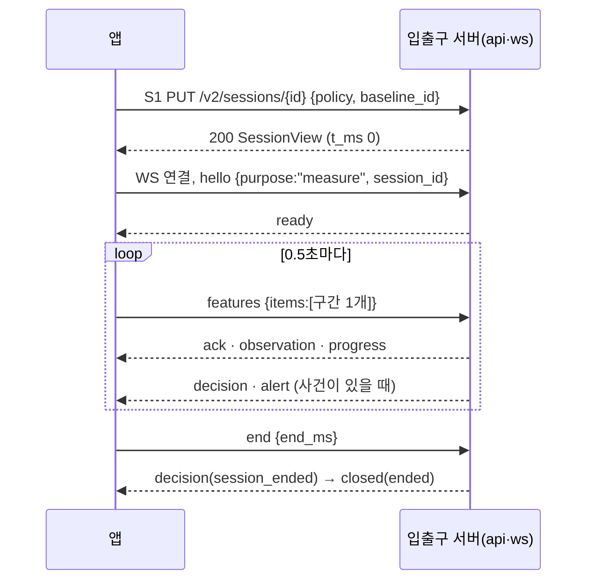

# 앱 ↔ 입출구 서버 연동 명세 (FE)

> 작성자: klaod-tech(FE) · 작성: 2026-10-13 · 최신화: 2026-10-22(문서 정리: BE 명세와 겹치는 본문·끝난 검토 답변(옛 0.1~0.6)을 빼고, FE 제안서 3·4장의 앱 동작을 이리로 옮김. 같은 날 코드 검토: S1·B1 무응답 재시도(1.1), S3는 앱이 부르지 않음(3·4장), B2 실패 때 등록을 자동으로 시작하지 않음(5.4)) · 대상: BE(입출구 서버 `auth`·`api`·`ws`), DevOps
> **이 문서의 역할:** 경로·필드·요청과 응답 본문은 [BE API 명세](api-spec.md)(이 저장소 `docs/design/api-spec.md`)가 기준이다. 이 문서는 그 위에 **앱이 언제 무엇을 부르고, 응답·메시지마다 어떻게 움직이는지**만 적는다.
> 결정의 근거는 ADR([0021](../decisions/0021-app-sends-information-server-judges.md) 앱은 판정하지 않음, [0024](../decisions/0024-session-ends-on-lost-connection.md) 끊기면 세션 종료, [0025](../decisions/0025-app-always-measures-on-server.md) 항상 서버로 측정, [0026](../decisions/0026-baseline-average-by-app-b1.md) 자세 등록 B1), 할 일과 지금 상태는 [FE 제안서](fe-server-proposal.md)다.
> **코드 읽는 법:** A1·S1처럼 글자+숫자는 BE 명세의 API 번호이고 3장 표에 경로와 부르는 때가 있다. F1~F15(FE 할 일)·BE-1~BE-3(BE 요청)은 [FE 제안서](fe-server-proposal.md) 7장·1장. 회원가입 동의 항목 C1~C6([동의 제안서](consent-proposal.md))은 API C1과 다른 번호다.
> 계약: [WebSocket v2](../../contracts/realtime/realtime-ws.v2.schema.json), [좌표 구간 posture.frames.v1](../../contracts/realtime/frames/posture-frames.v1.schema.json), [합성 예시](../../contracts/realtime/examples-v2/). 앱 코드: `frontend/src/features/session/live/`(측정), `features/baseline/`(등록), `features/platform/api.ts`(요청 공통).

## 0. BE 명세에 대해 FE가 정한 것과 요청

10/13~15의 검토 답변·차이 대조(옛 0.1~0.6)는 BE 명세에 반영돼 이 문서에서 뺐다([지운 문서 기록](../removed-docs.md) 6장, 원문은 `git show dc2c5d4:docs/design/api-ws-spec.md`). 지금 유효한 것만 남긴다.

| 항목 | 정한 것 |
|---|---|
| 5분 미만 세션 | 저장하고 기록 목록·일별 통계에 넣는다. 「붕괴까지 걸린 시간」 최소·최대에서만 뺀다(DB V2.3, 10/14 정정) |
| 세션 시작 시각 | 서버가 S1을 받은 시각 = 앱 `t_ms` 0. S1 응답(200 `SessionView`)에는 `started_at`이 없다 |
| 영상 크기 | 640×480 고정(팀 결정, DB V2.3 `CAPTURE_RESOLUTION`). 앱은 640×480을 요청하고 서버에 해상도를 보내지 않는다. 다른 크기여도 시작은 막지 않고, 측정 중 크기가 바뀌면 `end`로 끝낸다(10/21) |
| 오늘 기록 | 기록 목록에는 오늘 끝난 세션도 하나씩 보이고, 합산·그래프는 어제까지(일별 집계 J2 매일 00:00, 10/14) |
| 적재된 기록 삭제 | 지울 수 없다. R3가 409 `CONFLICT`면 「지금은 지울 수 없어요」(10/14) |
| 이름·나이·비밀번호 | 이름 1~30자, 나이 14~120, 비밀번호 72바이트는 앱이 검사한다. 12자 검사는 로그인을 서버에 이을 때 켠다 |
| 값이 없는 필드 | 빼지 않고 `null`로 보낸다(BE는 빠진 필드도 400) |
| 응답의 모르는 것 | 모르는 필드·`type`·`event.kind`는 무시한다 |

BE에 요청(선택): R1에 `?date=YYYY-MM-DD` 필터. 없으면 앱이 R1 전체를 받아 날짜로 거른다. 그 밖의 BE 진행 중인 것은 [FE 제안서](fe-server-proposal.md) 1장.

## 1. 공통 규칙

| 항목 | 규칙 (BE 명세 1장) | 앱이 하는 일 |
|---|---|---|
| 주소 | 앱은 `/api/v2/…`, WS는 `/api/v2/realtime`. 중계(nginx·Vite)가 `/api`를 뗀다 | 화면을 다른 곳(Vercel)에서 내면 `VITE_API_BASE_URL` 앞에 붙인다([배포](fe-deploy.md)). WS 주소는 그 주소나 페이지 주소로 만든다(`https:`면 `wss:`) |
| 로그인 | HttpOnly·SameSite=Lax 쿠키, 만료 30분. WS도 같은 쿠키. **WS 메시지는 만료를 늘리지 않는다.** 측정은 연결 때 인증했으므로 끝까지 간다 | 쿠키를 직접 다루지 않는다. 401이면 로그인 화면. 긴 측정 뒤 401이면 기록은 서버가 이미 저장했음을 알리고 로그인 화면으로 |
| CSRF | A1 토큰을 POST·PUT·DELETE의 `X-CSRF-TOKEN`에(가입·로그인 포함) | 앱 시작·로그인·로그아웃 뒤 다시 받는다. 403 `ACCESS_DENIED`면 한 번만 다시 받아 재시도 |
| 계정 헤더 | 보호 요청에 `X-PoseGood-User-Id` | 로그인·A4 응답의 `user_id`. 409 `AUTH_CHANGED`면 A4로 다시 받는다. 앱에서는 로그인 코드가 `setServerAuth({ userId, csrfToken })`로 넘긴다(`features/platform/serverAuth.ts`) |
| 시각 | 응답은 UTC ISO-8601, 측정 안 시간은 세션 시작 기준 ms | 화면에 보일 때만 KST로 |
| 판정 규칙 단위 | API·WS는 ms(`hold_ms`·`recovery_ms`·`reminder_ms`, 500의 배수, `reminder_ms` 1000 이상), `/v2/workspace` `rules`는 초 | W1 `rules`의 초에 1000을 곱해 S1 `policy`로. 계정 값과 다르면 409 `CONFLICT`이므로 W1 값을 그대로 쓴다(W1 연결 전에는 앱 기본값, FE 제안서 1장 BE-3) |
| 자세 방향 | `deviation_type`은 WS로만 온다. DB에 칸이 없다 | 측정 중 화면에서만 보인다 |

### 1.1 앱의 시간 규칙

| 상황 | 앱이 기다리는 시간 | 넘으면 |
|---|---|---|
| 502·503 재시도 | 1·2·4초 간격, 최대 3번(같은 본문) | 오류 안내 |
| 요청 응답 | 5초 | 「서버에 연결하지 못했어요」. S1·B1만 같은 본문으로 502·503과 같은 간격으로 다시 보낸다(둘 다 같은 요청이면 같은 결과, 10/22) |
| `hello` → `ready` | 5초 | 연결을 닫고 「서버에 연결하지 못했어요」. 그 세션은 끝난 것으로 보고 다시 할 때는 **새 `session_id`로 S1부터** |
| `features` | 0.5초마다 구간 1개. `t_ms` 0(S1 응답)부터 구간을 만들고, `ready` 전에 만든 구간은 `ready` 뒤 순번대로 1개씩 연달아 보낸다. 쉬는 중·카메라 영상 멈춤 중에도 빈 구간을 계속 보낸다 | — |
| 카메라 영상 | 프레임이 1초 넘게 없으면 `away` | 카메라가 돌아와야 「측정 재개」 |
| 측정 `end` → `closed(ended)` | 10초 | S4로 결과(실패하면 마지막 `progress`로 종료 화면) |
| 자세 등록 촬영 | 끊기지 않은 3초, 판정 가능 프레임 20장 이상. 추적 속도가 낮으면 20장까지 이어 찍는다 | 15초가 지나면 실패 안내 |

## 2. 오류 코드별 앱 동작

| HTTP | code | 앱 화면·동작 |
|---|---|---|
| 400 | `INVALID_CONTRACT` | 「요청을 보내지 못했어요」. 앱 버그로 기록 |
| 400 | `INVALID_PASSWORD` | 비밀번호 칸 아래 안내 |
| 400 | `CONSENT_REQUIRED` | 가입 1단계(약관 동의)로 |
| 401 | `UNAUTHENTICATED` | 로그인 화면 |
| 401 | `INVALID_CREDENTIALS` | 「이메일이나 비밀번호가 맞지 않아요」 |
| 403 | `ACCESS_DENIED` | CSRF 토큰을 다시 받아 한 번 재시도, 또 실패하면 새로고침 안내 |
| 403 | `ACCOUNT_CLOSED` | 탈퇴했고 최종 삭제 전인 계정(비밀번호가 맞을 때만 온다). 「자세한 사항을 아래 번호 또는 이메일로 남겨주세요. 010 - 1234 - 5678 / klaod@naver.com」(아래 탈퇴) |
| 404 | `SESSION_NOT_FOUND`·`SESSION_LOST` | 측정을 끝내고 마지막 `progress`로 종료 화면 |
| 404 | `BASELINE_NOT_FOUND` | 측정하기에서 자세 등록부터 |
| 409 | `AUTH_CHANGED` | A4로 계정을 다시 받고 화면을 새로 그린다 |
| 409 | `ACCOUNT_EXISTS` | 가입 2단계 이메일 칸 아래 안내 |
| 409 | `BASELINE_REQUIRED` | 「기준 자세가 없어요. 자세를 먼저 등록해 주세요」 |
| 409 | `CONFLICT` | R3(기록 삭제)면 「지금은 지울 수 없어요」. S1이면 설정·기준이 바뀐 것이라 W1·B2를 다시 받고 사용자가 다시 시작 |
| 409 | `SESSION_ENDED` | 종료 화면 |
| 429 | `LIMIT_REACHED` | 측정을 끝내고 새로 시작 안내 |
| 502·503 | `INFERENCE_FAILED`·`STORAGE_UNAVAILABLE`·`ACCOUNT_BUSY`·`SESSION_BUSY` | 1.1 재시도 |

**탈퇴는 되돌릴 수 없다**(BE 10/15, A8 철회 없음). 30일 뒤 최종 삭제는 Spark J3(매일 04:00).

| 경우 | 서버 | 앱 |
|---|---|---|
| A7 탈퇴 | 본문 `{password}`, 204 | 확인창에 「되돌릴 수 없고 30일 뒤 완전히 삭제되며, 그 전에는 같은 이메일로 다시 가입할 수 없어요」를 보이고 비밀번호를 받는다 |
| 탈퇴한 계정으로 로그인 | 비밀번호가 맞으면 403 `ACCOUNT_CLOSED`, 틀리면 401 | 403이면 위 연락처 안내, 401은 보통의 로그인 실패(탈퇴 여부가 드러나지 않음) |
| 최종 삭제 전 같은 이메일로 가입 | 409 `ACCOUNT_EXISTS` | 이메일 칸 안내 |

## 3. 엔드포인트 (앱이 부르는 때)

| ID | 메서드·경로 | 앱이 부르는 때 |
|---|---|---|
| A1 | `GET /v2/auth/csrf` | 앱 시작, 로그인·로그아웃·가입 뒤 |
| A2 | `POST /v2/auth/register` | 회원가입 2단계(계정 정보) 「다음」 |
| A3 | `POST /v2/auth/login` | 로그인 |
| A4 | `GET /v2/auth/me` | 앱 시작(쿠키가 살아 있으면 로그인 화면을 건너뜀), `AUTH_CHANGED` 뒤 |
| A5 | `POST /v2/auth/logout` | 계정 메뉴 「로그아웃」 |
| A6 | `PUT /v2/auth/password` | 설정 › 비밀번호 변경(뒤에는 모든 로그인이 끊기므로 로그인 화면으로) |
| A7 | `DELETE /v2/auth/account` | 프로필 › 탈퇴 |
| C1 | `PUT /v2/consents/optional-profile`(동의 항목 C1과 다름) | 프로필 › 선택 정보 동의 켜기·끄기 |
| W1 | `GET /v2/workspace` | 로그인·가입 직후 한 번 |
| W2 | `PUT /v2/workspace` | 설정·프로필 저장 |
| B1 | `POST /v2/baselines` | 자세 등록 촬영이 끝났을 때(앱이 낸 관절 9개 평균, 5.4) |
| B2 | `GET /v2/baselines/current` | 앱 시작·로그인 뒤 |
| S1 | `PUT /v2/sessions/{id}` | 「측정 시작」 |
| S3 | `POST /v2/sessions/{id}/end` | 10/22 기준 앱은 부르지 않는다(4장 S3·S4) |
| S4 | `GET /v2/sessions/{id}` | 측정 `end` 뒤 10초 안에 `closed`가 없을 때 |
| R1 | `GET /v2/records` | 기록 화면(W1의 `records`를 먼저 쓰고, 새로 고칠 때) |
| R1b | `GET /v2/records/{id}` | 종료 화면 대비책(S4 대신 써도 됨) |
| R3 | `DELETE /v2/records/{id}` | 기록 삭제 |
| T1 | `GET /v2/stats/daily?from&to` | 기록 화면의 지난 날짜 그래프·표 |
| WS | `/v2/realtime` | 측정(`purpose:"measure"`)만. 자세 등록 `purpose:"calibration"`은 쓰지 않는다(ADR 0026) |

R1b·T1은 BE 명세에 ID가 없어 FE가 붙인 이름이다. 앱이 **부르지 않는 것**: S2 `POST /v2/sessions/{id}/features`, R2 `POST /v2/records`, S5 metadata.

## 4. REST에서 앱이 지키는 것

본문은 BE 명세 4~8장이다.

- **A2 가입:** 회원가입은 3단계다(① 약관 동의 ② 계정 정보, 여기서 A2 ③ 자세 등록 선택). 필수 동의 5종(`AGE_14_OVER`·`TERMS`·`ACCOUNT_INFO`·`POSE_COORDINATES`·`MEASUREMENT_RECORD`, `document_version` `service-v2`)은 항상 보낸다. 선택 정보(`OPTIONAL_PROFILE`)에 동의했으면 목록에 더하고 `age`·`occupation`을 채우고, 비동의면 둘 다 `null`. 목록은 `features/auth/consents.ts`의 `consentPayload()`. 200이면 로그인된 상태라 A1 → W1 → 3단계로.
- **A3·A4 로그인:** A3 200 → A1 → W1 → 측정하기. A4 200(앱 시작)이면 로그인 화면을 건너뛴다. 측정 중 로그아웃·비밀번호 변경·탈퇴를 하면 서버가 WS를 `closed(unauthorized)`로 닫는다.
- **W1·W2·C1:** W1 `rules`는 판정 기준, `preferences.alerts_on`은 「자세 알림」. W2는 `{profile, rules, preferences}` 세 개를 모두 보내고 다음 측정부터 적용된다. API C1로 선택 정보 동의(동의 항목 C3)를 끄면 서버가 나이·직업을 비운다.
- **B1·B2:** 5.4.
- **S1:** `{policy, baseline_id}`. `policy`는 W1 `rules`를 ms로, `baseline_id`는 B2(또는 방금 B1) 값. 응답을 받은 순간이 `t_ms` 0이고 알림 여부는 W1 `alerts_on`을 쓴다. 응답을 못 받으면 같은 UUID·같은 본문으로 다시 보낸다.
- **S3·S4:** 측정 중 WS가 끊기면 서버가 마지막으로 받은 구간 끝에서 세션을 끝내고(BE `RealtimeHandlerV2.afterConnectionClosed`), `ready` 5초를 넘기면 서버가 끝낸다. 그래서 앱은 S3를 부르지 않는다(10/22, BE `047a095` 코드 확인). 남는 틈: S1은 됐는데 WS가 열리지 않았거나 `hello` 전에 끊기면 서버가 그 세션을 모른 채 열어 둔다. 이때만 S3로 닫을지 BE와 정한다(FE 제안서 7.2). S4는 `end` 뒤 10초 안에 `closed`가 없을 때, 또는 `end` 뒤 WS가 먼저 닫혔을 때 바로 한 번.
- **R1·R1b·T1:** R1은 앱 기록 형식(`RecordItem`, camelCase, `server.view` = `SessionView`) 그대로 받는다. 5분 미만 세션도 들어 있다. T1의 최소·최대 간격 = `min_`·`max_until_collapse_sec`. 기록·달력 화면 담당은 lellon0403(10/14).

## 5. WebSocket `/v2/realtime`

순서(BE 명세 11.1): `hello` → `ready` → `features` × N → `end` → `decision(session_ended)` → `closed(ended)`. 연결 하나가 측정 한 번이고 재연결은 없다(ADR 0024).

### 5.1 좌표 구간 (`posture.frames.v1`)

**0.5초에 구간 1개. 그 안에 찍힌 프레임을 평균 내지 않고 그대로 담는다**(`items`에 항상 1개, 약 2~7KB). 필드와 예시는 BE 명세 11.2와 계약.

- **관절:** 9개 `[x, y, visibility]` — 코·왼눈·오른눈·왼귀·오른귀·입 왼쪽·입 오른쪽·왼어깨·오른어깨(MediaPipe 0·2·5·7·8·9·10·11·12). 사람이 없으면 `p: null`(이때 `valid`는 넣지 않는다).
- **좌표:** MediaPipe 원본. x, y는 영상 크기에 대한 비율(소수 5자리), visibility는 소수 2자리. y는 아래로 커진다. 영상은 반전하지 않아 사용자 왼어깨가 화면 오른쪽(큰 x)에 있다.
- **가려진 관절도 좌표는 온다.** MediaPipe가 위치를 추정해 준다. 쓸지 말지는 서버가 정한다.
- **프레임 수는 일정하지 않다.** 보통 0.5초에 약 8개, 느린 PC는 3~5개. 시간은 개수가 아니라 `t_ms`로 센다. 시각은 앱 시계(`t_ms`·`start_ms`·`end_ms`) 기준이다.
- **`valid: false`:** 앱이 사용자 위치를 판별하지 못한 프레임에만 붙인다(어깨가 하나라도 안 보임. 2026-10-22부터 유예 없이 바로). 서버는 그 프레임을 판정에서 빼고 `UNMEASURABLE`로 센다.
- **왜 평균을 내지 않나:** 0.5초 안에 고개를 돌린 장·손에 가려진 장이 섞이면 평균이 가짜 치우침을 만든다. 어느 장을 뺄지도 판단이라 서버 몫이다.

### 5.2 쉬기·자리 비움·판정 불가·종료

일시정지·카메라 영상 멈춤·종료는 판단이 아니라 사실이라 앱이 알린다(메시지가 안 오는 것만으로는 네트워크 끊김과 구별할 수 없다). 처리는 세 가지뿐이다.

| 처리 | 원인 | 앱이 보내는 것 | DB 제외 사유 |
|---|---|---|---|
| ① 계속 측정, 그 프레임만 판정 불가 | 어깨가 안 보임, 얼굴·양쪽 어깨를 못 찾음, 사람이 없음 | `phase: "running"` 그대로, 프레임 `valid: false` 또는 `p: null` | `UNMEASURABLE` |
| ② 일시정지, 「측정 재개」로 이어 감 | 사용자 「잠시 쉬기」 | `phase: "rest"`, `frames: []` | `PAUSE` |
| | 카메라 영상이 1초 넘게 안 들어옴(연결은 그대로, 예: 다른 USB를 꽂음). 안내 「인식 중입니다. 3초 후에 측정 재개 버튼을 눌러주세요.」 | `phase: "away"`, `frames: []` | `ABSENCE` |
| ③ 측정 종료, 그때까지 저장 | 사용자 「측정 종료」, 작은 카메라 창 X(10/20), 쓰던 카메라가 빠짐(10/16), 측정 중 영상 크기가 바뀜(10/21) | `end {end_ms}` | — |
| | 앱을 닫거나 새로 고침, 네트워크 끊김 | (연결이 끊김) 서버가 마지막 구간 끝에서 끝내고 저장. 앱은 다시 연결하지 않는다 | — |
| | 일시정지가 10분 이어짐(10/20) | 서버가 자기 시계로 끝내고 알린다(BE). 앱에는 타이머가 없다 | — |
| | 서버가 닫음: `limit_reached`, `unauthorized`, `session_lost`, `server_shutdown` | 5.3 | — |

DB 규칙(V2.3)에 맞춰 앱이 지킬 것:

- 제외 사유는 하나만 붙는다(우선순위 `ABSENCE` → `PAUSE` → `MISSING` → `UNMEASURABLE`). 앱은 `rest`와 `away`를 겹쳐 보내지 않는다. 쉬는 중 카메라 영상이 멈추면 우선순위대로 `away`로 바꾼다(10/22 코드도 맞춤).
- 제외 구간의 시작·끝은 서버가 0.5초 경계에 맞춘다. 앱은 `rest`·`away`로 바뀐 시각을 `t_ms` 그대로 보낸다(그 시각에 구간을 닫는다).
- 앱은 `MISSING`을 보내지 않는다. 서버가 구간이 빠진 것을 찾으면(`event.reason` `missing`·`missing_sequence`) 서버가 저장한다.
- 짧은 끊김을 같은 사건으로 이을지(`EVENT_BREAK_SEC`), 판정 불가 시간을 빼는 규칙은 서버가 정한다. 앱은 받은 대로 보인다.

### 5.3 서버 → 앱

| `type` | 앱이 하는 일 |
|---|---|
| `ready` | `features`를 보내기 시작한다(밀린 구간부터) |
| `ack` | 아무것도 하지 않는다(재전송 없음) |
| `observation` | 상태 알약과 점수. 점수 = `100 × (1 − collapse_probability)`(`valid`일 때만). `invalid_reason`: `unmeasurable` 「얼굴과 어깨가 보이지 않아요」, `head_turn` 「고개를 돌린 동안은 판정하지 않아요」 |
| `progress` | 측정 시간·유지율·알림 수(`summary`). `paused_reason` |
| `decision` | 사건 표와 숫자. `collapse_confirmed`·`reminder`면 「자세가 흐트러졌어요」, `recovery_confirmed`·`interrupted`·`session_ended`면 해제 |
| `alert` | 토스트·소리·데스크톱 팝업. 앱은 거르지 않는다 |
| `stalled` | 「분석이 잠시 멈췄어요. 측정은 계속돼요」. 연결은 유지되고 다음 `observation`·`progress`가 오면 지운다 |
| `closed` | 아래 표 |

| `closed.reason` | 앱 |
|---|---|
| `ended` | 종료 화면 |
| `limit_reached` | 종료 화면 + 「한 번에 측정할 수 있는 시간을 넘어 측정을 마쳤어요」 |
| `session_lost`·`server_shutdown` | 종료 화면(끊기기 전까지 저장됨 안내) |
| `unauthorized` | 「로그인이 만료됐어요」, 로그인 화면 |
| `no_baseline` | 「기준 자세가 없어요」, 자세 등록으로 |
| `not_owner`·`bad_message` | 「측정을 이어갈 수 없어요」, 앱 버그로 기록 |

측정 화면의 상태(`features/session/live/LiveSessionPage.tsx`): 서버가 남은 시간을 주지 않으므로 확정·복귀까지의 진행 막대는 없다.

| 화면 상태 | 알약 문구 | 오는 것 |
|---|---|---|
| 연결 중 | 서버에 연결하고 있어요 | S1 응답 전·`ready` 전 |
| 바른 자세 | 바른 자세예요 | `observation.valid: true`, 열린 사건 없음 |
| 자세가 흐트러짐 | 자세가 흐트러졌어요(카메라 테두리 강조) | `decision(collapse_confirmed·reminder)` 뒤 해제 전 |
| 판정 불가 | 자세를 확인할 수 없어요 | `observation.valid: false` |
| 쉬는 중 | 쉬는 중 | 앱의 `rest` |
| 영상 기다림 | 카메라 영상을 기다리고 있어요 | 앱의 `away` |
| 분석 멈춤 | 연결 상태 칸에 안내 | `stalled` |
| 마무리 | 측정을 마무리하고 있어요 | `end` 뒤 `closed` 전 |

### 5.4 자세 등록 (B1·B2, ADR 0026)

10/20 전체 회의: **3초 동안의 자세 평균은 앱(FE)이 내서 B1로 보낸다.** WS 등록은 쓰지 않는다. 앱은 측정하기(등록한 자세가 없을 때), 설정의 「다시 등록」, 회원가입 3단계(선택)에서 등록한다.

| 단계 | 앱 | 서버 |
|---|---|---|
| 1 | 얼굴·어깨가 보이면 3·2·1 뒤 촬영. 판정 가능 프레임(코·양 어깨 visibility 0.65 이상, 화면 2% 안쪽, 어깨 폭이 화면 너비 10% 이상, 양 귀 좌표 있음, 어깨 유예 프레임 제외)만 쓰고, 쓸 수 없는 프레임이나 1초 넘는 빈틈이 있으면 처음부터 다시 센다 | — |
| 2 | 3초가 지나고 20장 이상이면 관절 9개 x·y를 **쓴 프레임 수로 나눈 단순 평균**(소수 5자리). 평균이 0~1 밖이면 보내지 않고 「화면 안으로」 안내 | — |
| 3 | B1 `{registered_at(촬영이 끝난 UTC), calibration_ms, sample_count, landmarks}`. 502·503은 같은 본문으로 재시도 | 새 행 저장(다시 등록할 때마다 새 행, 이력 보존), `baseline_id` 응답 |
| 4 | 응답의 `baseline_id`가 현재 기준. 앱을 켜거나 로그인하면 B2로 받는다(받기 전에는 등록을 시작하지 않음). 404면 등록부터. B2가 실패하면(연결·서버 오류) 서버에 기준이 있을 수 있어 등록을 자동으로 시작하지 않고 「다시 불러오기」·「새로 등록」을 고르게 한다(10/22) | — |

기준 특징값은 저장하지 않고 판정 때 서버가 좌표에서 계산한다. 이 PC에는 기준을 저장하지 않는다.

## 6. 흐름

### 6.1 측정 한 번

| 단계 | 앱 | 서버 |
|---|---|---|
| 1 | (앱 시작 때) B2 | 200 기준 / 404 → 자세 등록 |
| 2 | 「측정 시작」 → S1 `PUT /v2/sessions/{id}` `{policy, baseline_id}` | 200 `SessionView` (= `t_ms` 0) |
| 3 | WS 연결 → `hello {purpose:"measure", session_id}` | `ready` (5초 안) |
| 4 | 0.5초마다 `features {items:[구간 1개]}`(밀린 구간부터) | `ack`·`observation`·`progress`, 사건이 있으면 `decision`·`alert` |
| 5 | 「측정 종료」 → `end {end_ms}` | `decision(session_ended)` → `closed(ended)` (10초 안) |
| 6 | 10초 안에 `closed`가 없으면 S4 | 저장된 결과 |

### 6.2 가입·로그인

| 단계 | 앱 | 서버 |
|---|---|---|
| 1 | A1 | 토큰 |
| 2 | 가입: A2(4장) / 로그인: A3 | 200 사용자 + 쿠키 / 409 `ACCOUNT_EXISTS` / 401 / 403 `ACCOUNT_CLOSED` |
| 3 | A1 다시 → W1 → B2 | workspace, 기준 |
| 4 | 가입이면 3단계 자세 등록(5.4, 선택), 로그인이면 측정하기 | — |

### 6.3 측정 중 끊김

| 단계 | 앱 | 서버 |
|---|---|---|
| 1 | WS가 끊김. 재연결하지 않고 측정을 끝낸다(「서버 연결이 끊겨 측정을 마쳤어요. 끊기기 전까지 저장됐어요」, 화면을 막는 팝업 ADR 0024) | 마지막으로 받은 구간 끝에서 세션 종료·저장(BE 명세 11.3) |
| 2 | 마지막 `progress`로 종료 화면 | — |
