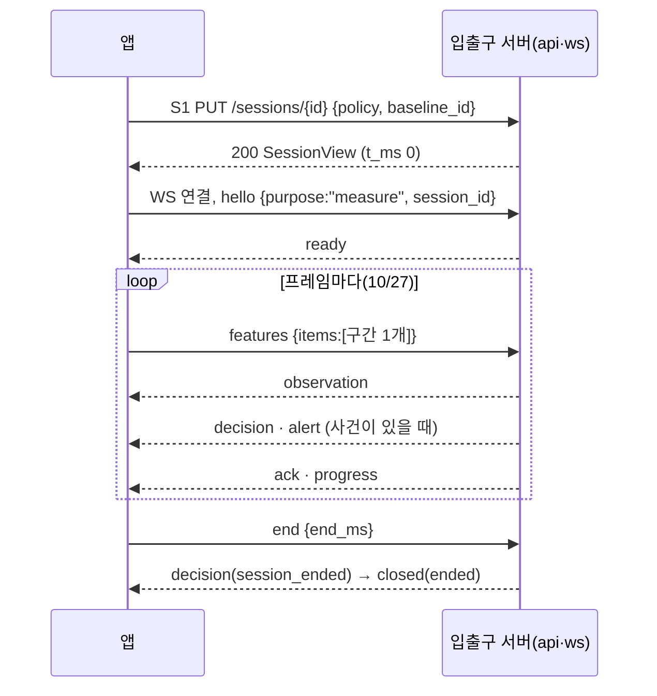

# 앱 ↔ 입출구 서버 연동 명세 (FE)

> 작성자: klaod-tech(FE) · 작성: 2026-10-13
> **이 문서의 역할:** FE의 API 명세다. **앱이 언제 무엇을 부르고, 응답·메시지마다 어떻게 움직이는지**를 적고, API별 표는 3장, 요청·처리·응답은 7장에 둔다. 필드 규칙이 어긋나면 [BE API 명세](../api-spec.md)(이 저장소 `docs/design/api-spec.md`)가 기준이다.
> 결정의 근거는 ADR([0021](../../decisions/0021-app-sends-information-server-judges.md) 앱은 판정하지 않음·항상 서버로 측정·자세 등록 B1·판정 불가 신호, [0024](../../decisions/0024-session-ends-on-lost-connection.md) 끊기면 세션 종료, [0027](../../decisions/0027-today-records-from-collected-server-results.md) 오늘 기록은 모은 서버 결과), 할 일과 지금 상태는 [FE 제안서](fe-server-proposal.md)다.
> **코드 읽는 법:** A1·S1처럼 글자+숫자는 BE 명세의 API 번호이고 3장 표에 경로와 부르는 때가 있다. F1~F15(FE 할 일)·BE-1~BE-13(BE 요청)은 [FE 제안서](fe-server-proposal.md) 7장·1장(남은 일 1.0, BE와 다른 곳 1.1, 요청 1.2). 회원가입 동의 항목 C1~C6([FE 기능 명세 회원가입](fe-feature-spec.md#회원가입))은 API C1과 다른 번호다.
> 계약: [WebSocket v2](../../../contracts/realtime/realtime-ws.v2.schema.json), [좌표 구간 posture.frames.v1](../../../contracts/realtime/frames/posture-frames.v1.schema.json), [합성 예시](../../../contracts/realtime/examples-v2). 앱 코드: `frontend/src/features/session/live/`(측정), `features/baseline/`(등록), `features/platform/api.ts`(요청 공통).

## 0. BE 명세에 대해 FE가 정한 것과 요청

10/13~15의 검토 답변·차이 대조(옛 0.1~0.6)는 BE 명세에 반영돼 이 문서에서 뺐다([지운 문서 기록](../../removed-docs.md) 6장, 원문은 `git show dc2c5d4:docs/design/api-ws-spec.md`). 지금 유효한 것만 남긴다.

| 항목 | 정한 것 |
|---|---|
| 5분 미만 세션 | 저장하고 기록 목록·일별 통계에 넣는다. 「붕괴까지 걸린 시간」 최소·최대에서만 뺀다(DB V2.3, 10/14 정정) |
| 세션 시작 시각 | 서버가 S1을 받은 시각 = 앱 `t_ms` 0. S1 응답(200 `SessionView`)에는 `started_at`이 없다 |
| 영상 크기 | 640×480 고정(팀 결정, DB V2.3 `CAPTURE_RESOLUTION`). 앱은 640×480을 희망값으로 요청하고 서버에 해상도를 보내지 않는다. 4:3이 아니게 열리면 같은 카메라를 4:3 필수로 다시 열어 브라우저가 잘라 주게 하고, 그래도 4:3이 아니면 카메라를 쓰지 않는다([ADR 0048](../../decisions/0048-camera-picture-is-four-by-three.md), 11/12). 측정 중 크기가 바뀌면 `end`로 끝낸다(10/21) |
| 오늘 기록 | 결과 화면에는 방금 끝난 세션만. 목록·합산·달력·그래프는 R1로 받은 기록을 앱이 집계한다. T1을 붙이면 어제까지의 통계에 쓴다(ADR 0027, 4.5) |
| 모델명·버전 | `model_version`·`feature_version` 등은 개발·연동용 내부 정보라 서비스 화면에 보이지 않는다. API·WS 필드와 검증은 그대로(10/22 팀장 결정, [내부 관리 기준](../../../contracts/README.md#모델명특징-버전의-내부-관리)) |
| 이름·나이·비밀번호 | 이름 1~30자, 나이 14~120, 비밀번호 12자 이상·72바이트 이하는 앱이 보내기 전에 검사한다 |
| 값이 없는 필드 | 빼지 않고 `null`로 보낸다(BE는 빠진 필드도 400) |
| 응답의 모르는 것 | 모르는 필드·`type`·`event.kind`는 무시한다 |

BE에 요청(선택): R1에 `?date=YYYY-MM-DD` 필터. 없으면 앱이 R1 전체를 받아 날짜로 거른다. 그 밖의 BE 진행 중인 것은 [FE 제안서](fe-server-proposal.md) 1장.

## 1. 공통 규칙

| 항목 | 규칙 (BE 명세 1장) | 앱이 하는 일 |
|---|---|---|
| 주소 | 앱은 `/api/…`(예: `/api/auth/login`), WS는 `/api/realtime`. 주소에 버전이 없다(2026-11-09). 중계(nginx·Vite)가 `/api`를 뗀다 | 화면을 다른 곳(Vercel)에서 내면 `VITE_API_BASE_URL` 앞에 붙인다([FE 제안서](fe-server-proposal.md) 9장). WS 주소는 그 주소나 페이지 주소로 만든다(`https:`면 `wss:`) |
| 로그인 | access 토큰(JWT, 30분) + refresh 토큰(14일, HttpOnly 쿠키 `posegood_refresh`, SameSite=Lax, Path `/`)([BE ADR 0031](../../decisions/0031-jwt-access-refresh-login.md), 2026-10-27 develop PR #68). 쿠키 세션·CSRF·A1·30분 고정은 없어졌다(DB V2.6 `refresh_token`). 측정은 연결 때 인증했으므로 만료돼도 끝까지 간다 | access 토큰을 **메모리에만** 두고 보호 요청에 `Authorization: Bearer`, `credentials: 'include'`는 refresh 쿠키 때문에 유지(`features/auth/accountClient.ts`, `features/platform/api.ts`). 로그아웃·비밀번호 변경 뒤에는 들고 있던 access 토큰을 버린다(서버는 access 토큰을 철회하지 않아 최대 30분 통함) |
| 로그인 유지(A8) | `POST /auth/refresh`(본문 없음, refresh 쿠키가 실림) → `{user_id, access_token, token_type, expires_in, today}` + 새 refresh 쿠키. refresh 토큰은 쓸 때마다 바뀌고, 바뀐 뒤 30초 안의 재사용(여러 탭 동시 갱신)은 한 번 더 새 토큰을 준다. 그 뒤 재사용은 탈취로 보고 그 사용자의 refresh 토큰을 모두 철회한다. 실패하면 401 + 쿠키 삭제. A2·A3 응답에도 `access_token`·`token_type`·`expires_in`이 붙는다. 로그아웃은 이 기기, 비밀번호 변경·탈퇴는 모든 기기의 refresh 토큰을 철회하고 열린 WS를 `closed(unauthorized)`로 닫는다. WS는 `hello`에서만 인증하므로 측정 중에는 갱신이 필요 없다 | **미리 갱신:** `expires_in` 기준 만료 1~2분 전에 A8. **예비:** 보호 요청이 401이면 A8을 한 번 하고 원래 요청을 다시 보낸다(숨은 탭·절전으로 타이머가 늦을 때). 갱신은 동시에 하나만(다른 요청은 그 결과를 기다림), 탭 사이에는 새 토큰을 나눈다(`BroadcastChannel`). A8이 401이면 로그인 화면, 네트워크 오류·5xx면 로그아웃하지 않고 다시 시도. **앱 시작:** 메모리에 토큰이 없으므로 A8로 토큰을 받고(실패하면 로그인 화면) A4(BE 코드로 확인함, FE 제안서 BE-12 ①). WS 연결 직전에 만료가 가까우면 먼저 갱신 |
| 계정 헤더 | 보호 요청에 `X-PoseGood-User-Id` | 로그인·A4 응답의 `user_id`. 409 `AUTH_CHANGED`면 A4로 다시 받는다. 앱에서는 로그인 코드가 `setServerAuth({ userId, accessToken })`로 넘긴다(`features/platform/serverAuth.ts`) |
| 시각 | 응답은 UTC ISO-8601, 측정 안 시간은 세션 시작 기준 ms | 화면에 보일 때만 KST로. **화면의 날짜·시각은 서버 시각을 따르고 앱은 시간을 세지 않는다**([ADR 0029](../../decisions/0029-midnight-cut-and-server-time.md)): 기록 시작·종료 = `ready.started_at`·`closed.ended_at`, 오늘 = 가장 최근에 받은 서버 날짜(A4 `today` — 앱 시작·창으로 돌아올 때·기록·달력을 열 때, R1·T1 `today`, 그리고 `ready`·`closed` 시각의 KST 날짜). 날짜는 서버가 KST `YYYY-MM-DD`로 정해 주고 앱은 계산하지 않는다(10/26 FE: 앱은 시각이 필요 없어 A4 `server_time`은 요청에서 뺌). 측정 안 시간축(`t_ms`)과 자세 등록 3초는 앱 시계. `ready.started_at`·`closed.ended_at`(`b903751`)과 A2·A3·A4 `today`(`d27a97d`)는 10/27 PR #65로 develop에 들어갔다. 값이 오기 전에는 PC 시계를 KST로 고정해 대신 쓴다 |
| 자정 | KST 00:00에 서버가 진행 중인 측정을 끝내 저장하고, 같은 연결에서 **서버가 만든 새 세션**으로 잇는다(BE-6 ① B안, BE 10/28 구현, 설정 `midnight-rollover` 기본 꺼짐 — BE api-spec 11.3) | `session_rollover`를 받으면 `ended`(이전 세션)를 기록으로 닫고 새 `session_id`·`started_at`(= 자정)으로 이어 간다. S1·`hello`는 다시 하지 않고 시간·순번은 연결 기준으로 계속 보낸다(서버가 바꿔 씀). 실패 사유 `closed(day_changed)`면 저장된 것으로 마친다. 하나의 측정은 하루 안에 있다(10/30 FE 처리) |
| 판정 규칙 단위 | API·WS는 ms(`hold_ms`·`recovery_ms`·`reminder_ms`, 500의 배수, `reminder_ms` 1000 이상), `/workspace` `rules`는 초 | 판정 기준은 서버 계정에만 둔다(11/10). 앱은 로그인 뒤와 측정하기·설정 화면을 열 때 W1 `rules`를 받고, 설정을 바꾸면 W2로 저장한다. 이 기기에는 남기지 않는다. S1 `policy`는 W1 `rules`의 초에 1000을 곱한 값이다. 서버는 계정 값과 다르면 409 `CONFLICT`로 거절하므로(11/10 실제 서버 확인: 기기에만 바꾼 값은 409, W2로 저장한 값은 200), 다른 기기에서 바꾼 직후라면 측정하기 화면을 다시 열어 W1을 받는다. S1에서 `policy`를 빼는 안(10/27)은 앱이 W1의 계정 값을 보내 서버 값과 같아져 접었다(11/10). 3초·60초 규칙을 세는 것은 그 뒤에도 서버다(구간 시간으로) |
| 자세 방향 | `deviation_type`은 WS로만 온다. DB에 칸이 없다 | 측정 중 화면에서만 보인다 |

### 1.1 앱의 시간 규칙

| 상황 | 앱이 기다리는 시간 | 넘으면 |
|---|---|---|
| 502·503 재시도 | 1·2·4초 간격, 최대 3번(같은 본문) | 오류 안내 |
| 요청 응답 | 5초 | 「서버에 연결하지 못했어요」. S1·B1만 같은 본문으로 502·503과 같은 간격으로 다시 보낸다(둘 다 같은 요청이면 같은 결과, 10/22) |
| `hello` → `ready` | 5초 | 연결을 닫고 「서버에 연결하지 못했어요」. 그 세션은 끝난 것으로 보고 다시 할 때는 **새 `session_id`로 S1부터** |
| `features` | **프레임마다 구간 1개**(10/27 팀장 결정, 5.1). `t_ms` 0(S1 응답)부터 구간을 만들고, `ready` 전에 만든 구간은 `ready` 뒤 순번대로 1개씩 연달아 보낸다. 쉬는 중·카메라 영상 멈춤 중에도 빈 구간을 계속 보낸다 | — |
| 카메라 영상 | 프레임이 1초 넘게 없으면 `away` | 카메라가 돌아와야 「측정 재개」 |
| 측정 `end` → `closed(ended)` | 10초 | S4로 결과(실패하면 마지막 `progress`로 종료 화면). 이 10초 동안 화면을 덮는 「결과를 저장하고 있어요」 로딩을 띄우고 창 닫기를 막는다(10/27 정함, 계획 0059 정한 것 4⑤ — 아직 코드 전, lellon0403 확인) |
| 자세 등록 촬영 | 끊기지 않은 3초, 판정 가능 프레임 20장 이상. 추적 속도가 낮으면 20장까지 이어 찍는다 | 15초가 지나면 실패 안내 |

## 2. 오류 코드별 앱 동작

| HTTP | code | 앱 화면·동작 |
|---|---|---|
| 400 | `INVALID_CONTRACT` | 「요청을 보내지 못했어요」. 앱 버그로 기록 |
| 400 | `INVALID_PASSWORD` | 비밀번호 칸 아래 안내 |
| 400 | `CONSENT_REQUIRED` | 가입 1단계(약관 동의)로 |
| 401 | `UNAUTHENTICATED` | 로그인 화면 |
| 401 | `INVALID_CREDENTIALS` | 「이메일이나 비밀번호가 맞지 않아요」 |
| 403 | `ACCESS_DENIED` | 접근 거부. 일반 오류로 안내(토큰 로그인 뒤 CSRF는 없다) |
| 403 | `ACCOUNT_CLOSED` | 탈퇴했고 최종 삭제 전인 계정(비밀번호가 맞을 때만 온다). 「탈퇴한 계정입니다. 되돌릴 수 없고 탈퇴 30일 뒤 삭제됩니다.」 |
| 404 | `SESSION_NOT_FOUND`·`SESSION_LOST` | 측정을 끝내고 마지막 `progress`로 종료 화면 |
| 404 | `BASELINE_NOT_FOUND` | 측정하기에서 자세 등록부터 |
| 409 | `AUTH_CHANGED` | A4로 계정을 다시 받고 화면을 새로 그린다 |
| 409 | `ACCOUNT_EXISTS` | 가입 2단계 이메일 칸 아래 안내 |
| 409 | `BASELINE_REQUIRED` | 「기준 자세가 없어요. 자세를 먼저 등록해 주세요」 |
| 409 | `CONFLICT` | S1이면 설정·기준이 바뀐 것이라 W1·B2를 다시 받고 사용자가 다시 시작 |
| 429 | `LIMIT_REACHED` | 측정을 끝내고 새로 시작 안내 |
| 502·503 | `STORAGE_UNAVAILABLE`·`ACCOUNT_BUSY`·`SESSION_BUSY` | 1.1 재시도 |

**탈퇴는 되돌릴 수 없다**(BE 10/15, A8 철회 없음). 30일 뒤 최종 삭제는 Spark J3(매일 04:00).

| 경우 | 서버 | 앱 |
|---|---|---|
| A7 탈퇴 | 본문 `{password}`, 204 | 확인창에 「되돌릴 수 없고 30일 뒤 완전히 삭제되며, 그 전에는 같은 이메일로 다시 가입할 수 없어요」를 보이고 비밀번호를 받는다 |
| 탈퇴한 계정으로 로그인 | 비밀번호가 맞으면 403 `ACCOUNT_CLOSED`, 틀리면 401 | 403이면 위 탈퇴 안내, 401은 보통의 로그인 실패(탈퇴 여부가 드러나지 않음) |
| 최종 삭제 전 같은 이메일로 가입 | 409 `ACCOUNT_EXISTS` | 이메일 칸 안내 |

## 3. API 목록

경로는 서버 기준이다. 앱은 앞에 `/api`를 붙여 부른다(1장). 기능명은 [FE 기능 명세](fe-feature-spec.md)와 같고, 요청과 응답은 [7장](#7-api-상세)에 있다. **앱 사용**은 2026-11-09 코드 기준이다. `사용`, `안 씀`(서버에는 있음), `서버 없음`(구현 전)으로 적는다.

### auth | 인증

| ID | 메서드 | API 이름 | URI | Query Params | 기능명 | 앱이 부르는 때 | 앱 사용 |
|---|---|---|---|---|---|---|---|
| [A2](#api-a2) | POST | 회원가입 | `/auth/register` | | 회원가입 | 회원가입 2단계(계정 정보) 「다음」 | 사용 |
| [A3](#api-a3) | POST | 로그인 | `/auth/login` | | 로그인 | 로그인 | 사용 |
| [A4](#api-a4) | GET | 내 정보 조회 | `/auth/me` | | 로그인 유지 | 앱 시작(A8로 토큰을 받은 다음), `AUTH_CHANGED` 뒤. 서버 시각용으로도: 창·탭으로 돌아올 때, 기록·달력을 열 때(1분에 한 번까지, 로그인 상태는 바꾸지 않음, ADR 0029) | 사용 |
| [A5](#api-a5) | POST | 로그아웃 | `/auth/logout` | | 로그아웃 | 계정 메뉴 「로그아웃」 | 사용 |
| [A6](#api-a6) | PUT | 비밀번호 변경 | `/auth/password` | | 비밀번호 변경 | 프로필 › 비밀번호 변경(뒤에는 모든 로그인이 끊기므로 로그인 화면으로) | 사용 |
| [A7](#api-a7) | DELETE | 탈퇴 접수 | `/auth/account` | | 회원탈퇴 | 프로필 › 탈퇴 | 사용 |
| [A8](#api-a8) | POST | 로그인 유지 | `/auth/refresh` | | 로그인 유지 | 만료 1분 30초 전, 401 뒤 한 번, 앱 시작 때(1장 「로그인 유지」) | 사용 |

### workspace | 동의·설정

| ID | 메서드 | API 이름 | URI | Query Params | 기능명 | 앱이 부르는 때 | 앱 사용 |
|---|---|---|---|---|---|---|---|
| [C1](#api-c1) | PUT | 선택 정보 동의·철회 | `/consents/optional-profile` | | 선택 정보 동의 철회 | 부르는 화면 없음(동의 항목 C1과 다른 번호) | 삭제(11/12) |
| [W1](#api-w1) | GET | 설정·기록 조회 | `/workspace` | | 프로필 수정, 판정 기준 설정 | 로그인 뒤, 측정하기·설정·프로필 화면을 열 때, W2 저장 직전 | 사용 |
| [W2](#api-w2) | PUT | 설정 저장 | `/workspace` | | 프로필 수정, 판정 기준 설정 | 프로필 저장, 설정 화면에서 판정 기준을 바꿀 때 | 사용 |

### baselines | 기준 자세

| ID | 메서드 | API 이름 | URI | Query Params | 기능명 | 앱이 부르는 때 | 앱 사용 |
|---|---|---|---|---|---|---|---|
| [B1](#api-b1) | POST | 기준 자세 등록 | `/baselines` | | 기준 자세 등록 | 자세 등록 촬영이 끝났을 때(앱이 낸 관절 9개 평균, 5.4) | 사용 |
| [B2](#api-b2) | GET | 현재 기준 자세 조회 | `/baselines/current` | | 기준 자세 등록 | 앱 시작·로그인 뒤 | 사용 |

### sessions | 측정 세션

| ID | 메서드 | API 이름 | URI | Query Params | 기능명 | 앱이 부르는 때 | 앱 사용 |
|---|---|---|---|---|---|---|---|
| [S1](#api-s1) | PUT | 세션 생성 | `/sessions/{id}` | | 측정 시작 | 「측정 시작」 | 사용 |
| [S3](#api-s3) | POST | 세션 종료 | `/sessions/{id}/end` | | 측정 종료 | 부르지 않는다. 측정은 WS `end`로 끝낸다(4장 S3·S4) | 삭제(11/12) |
| [S4](#api-s4) | GET | 세션 상태 조회 | `/sessions/{id}` | | 측정 종료 | `end` 뒤 10초 안에 `closed`가 없을 때. 서버 **메모리**의 세션만 읽는다(끝난 뒤 30분 보관, 서버 재시작 때 사라짐). 못 받아도 앱이 R1(DB)로 저장을 확인한다 | 사용 |

### realtime | 실시간

| ID | 메서드 | API 이름 | URI | Query Params | 기능명 | 앱이 부르는 때 | 앱 사용 |
|---|---|---|---|---|---|---|---|
| [WS](#api-ws) | WS | 실시간 측정 | `/realtime` | | 실시간 판정 수신 | 측정 시작 뒤 연결(`purpose: "measure"`만) | 사용 |

### records | 기록·통계

| ID | 메서드 | API 이름 | URI | Query Params | 기능명 | 앱이 부르는 때 | 앱 사용 |
|---|---|---|---|---|---|---|---|
| [R1](#api-r1) | GET | 기록 목록 조회 | `/records` | | 측정 결과 보관, 기록 조회 | 로그인·계정이 바뀔 때, 측정이 끝난 뒤, 저장 확인 다시 시도 | 사용 |
| [R1b](#api-r1b) | GET | 기록 하나 조회 | `/records/{id}` | | 기록 조회 | 서버에 없음(BE-2) | 서버 없음 |
| [R3](#api-r3) | DELETE | 기록 삭제 | `/records/{id}` | | 기록 삭제 | 부르는 화면 없음 | 삭제(11/12) |
| [T1](#api-t1) | GET | 일별 통계 조회 | `/stats/daily` | `from`, `to` | 기간 통계 | 서버에 없음, 형식만 확정(BE-2) | 서버 없음 |

### system | 시스템

| ID | 메서드 | API 이름 | URI | Query Params | 기능명 | 앱이 부르는 때 | 앱 사용 |
|---|---|---|---|---|---|---|---|
| [H1](#api-h1) | GET | 상태 확인 | `/health` | | 없음(배포 점검) | 부르지 않는다 | 안 씀 |

삭제된 API: A1 CSRF(10/27), S2 구간 입력·S5 메타데이터·S6 세션 삭제·R2 기록 저장(10/28, [계획 0062](../../plans/active/0062-remove-unused-apis.md)). R1b·T1은 BE 명세에 ID가 없어 FE가 붙인 이름이다.

## 4. REST에서 앱이 지키는 것

요청과 응답은 7장이다.

- **A2 가입:** 회원가입은 3단계다(① 약관 동의 ② 계정 정보, 여기서 A2 ③ 자세 등록 선택). 필수 동의 5종(`AGE_14_OVER`·`TERMS`·`ACCOUNT_INFO`·`POSE_COORDINATES`·`MEASUREMENT_RECORD`, `document_version` `service-v2`)은 항상 보낸다. 선택 정보(`OPTIONAL_PROFILE`)에 동의했으면 목록에 더하고 `age`·`occupation`을 채우고, 비동의면 둘 다 `null`. 목록은 `features/auth/consents.ts`의 `consentPayload()`. 200이면 로그인된 상태라 3단계로 간다.
- **A3·A4 로그인:** A3 200의 `access_token`을 메모리에 두고 홈으로 간다. B2와 R1을 받는다. 앱 시작 때는 A8 200 → A4로 로그인 화면을 건너뛴다. 측정 중 비밀번호 변경·탈퇴를 하면 서버가 WS를 `closed(unauthorized)`로 닫는다. `hello`에는 `access_token`이 필수다.
- **W1·W2:** 프로필 화면은 저장 직전에 W1을 다시 받아 다른 화면에서 바뀌지 않았는지 확인하고, `profile`만 바꿔 W2로 보낸다. 설정 화면은 판정 기준을 바꿀 때마다 W1으로 최신 `profile`·`preferences`를 받아 그대로 두고 `rules`만 바꿔 W2로 보낸다(`features/storage/serverWorkspace.ts`). 연달아 바꾸면 마지막 요청의 결과만 쓴다. 저장에 실패하면 W1을 다시 받아 화면 값을 서버 값으로 되돌린다. 자세 알림(`alerts_on`)은 설정 화면에서 바꾸지 않는다. W2는 `{profile, rules, preferences}` 세 개를 모두 보내고 다음 측정부터 적용된다. API C1로 선택 정보 동의(동의 항목 C3)를 끄면 서버가 나이·직업을 비우지만, 앱에는 아직 부르는 화면이 없다.
- **B1·B2:** 5.4.
- **S1:** `{policy, baseline_id}`. `policy`는 W1에서 받은 판정 기준을 ms로(1장), `baseline_id`는 B2(또는 방금 B1) 값. 응답을 받은 순간이 `t_ms` 0이다. 알림 여부는 서버가 계정 값을 세션에 고정해 `alert` 전송으로 정한다. 응답을 못 받으면 같은 UUID·같은 본문으로 다시 보낸다.
- **S3·S4:** 측정 중 WS가 끊기면 서버가 마지막으로 받은 구간 끝에서 세션을 끝내고(BE `RealtimeHandlerV2.afterConnectionClosed`), `ready` 5초를 넘기면 서버가 끝낸다. 그래서 앱은 S3를 부르지 않았고(10/22, BE `047a095` 코드 확인), S3는 2026-11-12 서버에서 지웠다. 남는 틈: S1은 됐는데 WS가 열리지 않았거나 `hello` 전에 끊기면 서버가 그 세션을 모른 채 열어 둔다. 닫을 길은 BE와 정한다(FE 제안서 1.0 — 서버는 메모리에서만 6시간 뒤 빼고 DB 행은 `ended_at` NULL로 남는다, `LiveSessions.evict`). S4는 `end` 뒤 10초 안에 `closed`가 없을 때, 또는 `end` 뒤 WS가 먼저 닫혔을 때 바로 한 번.
- **R1·R1b·T1:** 아래 4.5.

### 4.5 기록·통계 R1·R1b·R3·T1 (BE 다음 주 범위)

**응답 형식(BE 10/27 `d27a97d`·`fdd1269`):** R1은 배열이 아니라 `{ "today": "YYYY-MM-DD", "records": [RecordItem…] }`(최신순)이고, 앱은 `records`를 읽고 `today`로 「오늘」을 갱신한다. T1(구현 전, 형식 확정)은 `{ today, from, to, days }`이고 `to`는 어제까지로 잘린다. `days`의 필드는 DB `daily_stat` 칸 이름 그대로(`stat_date`·`valid_sec`·`good_sec`·`session_count`·`event_count`·`alerted_event_count`·`min_`·`max_until_collapse_sec`·`computed_at`), 빈 날은 0으로 채우고 min·max·`computed_at`은 null. J2가 돌기 전에는 0만 온다. 앱은 R1을 부르고(`features/storage/serverRecords.ts`), T1은 서버에 없어 부르지 않는다. R1의 `RecordItem`은 앱 기록 형식(camelCase, `server.view` = `SessionView`) 그대로다. 5분 미만 세션도 들어 있다. T1의 최소·최대 간격 = `min_`·`max_until_collapse_sec`. R3가 409 `CONFLICT`(적재된 세션)면 「지금은 지울 수 없어요」. 기록·달력 화면 담당은 lellon0403(10/14). 11/9 기준 서버에 R1b·T1이 아직 없다(BE-2).

**오늘과 과거의 데이터 출처([ADR 0027](../../decisions/0027-today-records-from-collected-server-results.md), 11/9 고침):** 측정은 끝날 때 서버에 저장되고 R1이 오늘 세션까지 돌려주므로 기록은 R1 하나로 본다. R1 값은 메모리에만 두고 앱을 열 때마다 다시 받는다. localStorage에는 서버 확인 전 결과만 계정별 키(`posegood.account.v3.{user_id}.pending-results`)에 두고, R1에서 확인되면 지운다(`features/storage/serverRecords.ts`).

| 표시 대상 | 출처·처리 |
|---|---|
| 측정 종료 결과 | 방금 끝난 세션의 서버 결과만. 앞선 세션과 합치지 않는다 |
| 오늘 세션 목록·요약 | R1 기록 중 오늘 세션. 유지율 = 바른 자세 시간 합 / 유효 측정 시간 합 |
| 달력·잔디, 날짜 상세 | R1 기록을 KST 날짜로 나눠 집계(`features/history/recordsSource.ts`) |
| 최근 7일·30일 등 기간 화면 | 지금은 R1 기록을 집계한다. T1을 붙이면 어제까지는 T1, 오늘은 R1로 하고 같은 날짜를 겹쳐 더하지 않는다 |
| 서버 확인 전 결과 | 기록에 섞지 않고 「서버 저장 확인을 기다리는 기록 N개」로 알린다 |

**T1 데이터가 생기는 시각(11/2 추가):** T1의 `daily_stat`은 Spark J2가 **매일 00:10**(KST)에 어제부터 7일 전까지를 다시 계산해 바뀐 날만 쓴다(11/1부터, 7일 다시 계산은 11/8부터 — D-81, PR #100, 계획 0085). 00:00~00:10에는 앱의 「오늘」이 이미 바뀌었는데 T1은 어제를 0으로 준다. 어떻게 보일지(그 10분만 어제를 로컬 기록으로 보이기 — 위 「더하지 않는다」의 예외로 적어야 함 — 또는 「집계 중」 표시 뒤 다시 부르기)는 T1을 붙일 때 정한다. 「아직 집계 전」을 구별할 값이 필요한지도 그때 BE와 정한다(지금 T1 형식에는 없다). J2는 그 시각에 끝난 세션만 세므로, 서버 자정 넘김이 꺼져 있으면 자정을 넘긴 측정은 끝난 다음 날의 J2가 시작 날짜에 넣을 때까지 T1에 없다. 7일보다 늦게 닫힌 세션은 자동으로 들어가지 않는다(운영에서 켜는 일은 FE 제안서 1.0).

오늘·어제는 서버 통계와 같은 KST 날짜로 나눈다. 측정은 자정에 서버가 끊으므로 세션의 시작 날짜 = 끝난 날짜이고, 기록은 시작 시각(`ready.started_at`)의 KST 날짜에 넣는다. 오늘이 며칠인지는 가장 최근에 받은 서버 시각으로 정한다(ADR 0029). 같은 세션 UUID는 덮어써 중복으로 쌓지 않는다. 서버가 보낸 결과를 모아 보이는 것이며 앱이 자세를 다시 판정하지 않는다.

## 5. WebSocket `/realtime`

순서(BE 명세 11.1): `hello` → `ready` → `features` × N → `end` → `decision(session_ended)` → `closed(ended)`. 연결 하나가 측정 한 번이고 재연결은 없다(ADR 0024).

### 5.1 좌표 구간 (`posture.frames.v1`)

**프레임마다 구간 1개**(2026-10-27 팀장 결정, 그 전에는 0.5초에 구간 1개). 구간 `[start_ms, end_ms)`에는 프레임 1장이 들어 있고 다음 프레임이 찍힐 때 끝난다(보통 약 0.1초, 초당 약 10개, 하나에 약 0.5KB). 0.5초 동안 새 프레임이 없으면 그때 구간을 닫아 시간이 끊기지 않게 한다(빈 구간 포함). `items`에는 항상 구간 1개. 서버는 구간을 받으면 바로 추론·판정해 `observation` → (`decision` → `alert`) → `ack` → `progress` 순서로 보낸다(구간마다, 프레임마다). 판정 시간은 구간 `start_ms`·`end_ms`로 센다(`t_ms`는 서버가 형식만 검사한다, BE 명세 11.2). 11/1에 들어간 서버 3초 묶음(PR #91)은 경고가 최대 3초 늦어져 11/2 되돌렸다(PR #95). 필드와 예시는 BE 명세 11.2와 계약.

- **관절:** 9개 `[x, y, visibility]` — 코·왼눈·오른눈·왼귀·오른귀·입 왼쪽·입 오른쪽·왼어깨·오른어깨(MediaPipe 0·2·5·7·8·9·10·11·12). 사람이 없으면 `p: null`(이때 `valid`는 넣지 않는다).
- **좌표:** MediaPipe 원본. x, y는 영상 크기에 대한 비율(소수 5자리), visibility는 소수 2자리. y는 아래로 커진다. 영상은 반전하지 않아 사용자 왼어깨가 화면 오른쪽(큰 x)에 있다.
- **범위:** 서버는 x·y가 -1~2, visibility가 0~1을 벗어난 관절이 하나라도 있으면 그 구간을 거절하고 `closed(bad_message)`로 측정을 끝낸다(BE `FrameInterval`). 그래서 앱이 범위 안으로 자르고, 추적기가 주지 않았거나 숫자가 아닌 관절은 `[0, 0, 0]`으로 채운 뒤 그 프레임을 `valid:false`로 보낸다(10/22. 서버는 귀 좌표를 visibility 없이 쓰므로 채운 값이 실제 위치로 판정에 들어가지 않게).
- **가려진 관절도 좌표는 온다.** MediaPipe가 위치를 추정해 준다. 어깨가 화면 안에 있고 9개 관절 값이 모두 있으면 좌표를 보내고, 쓸지 말지(정확도·가장자리·거리·고개 돌림)는 서버가 정한다.
- **프레임 간격은 일정하지 않다.** 보통 초당 약 10~16장, 느린 PC는 6~10장이라 구간 길이도 그만큼 달라진다. 시간은 개수가 아니라 `t_ms`로 센다. 시각은 앱 시계(`t_ms`·`start_ms`·`end_ms`) 기준이다. 서버는 3초 확정·회복·다시 알림을 구간 시간으로 센다(서버 현재 시각을 쓰지 않음 — 도착 시각이 아니라 찍은 시각이라 네트워크 지연이 섞이지 않는다). 「`t_ms` 대신 앱이 세서 확정」 안은 회의 안건이다([FE 제안서](fe-server-proposal.md) 7.2 22번).
- **`valid: false`:** 앱이 사용자 위치를 판별하지 못한 프레임(어깨가 하나라도 안 보임, 2026-10-22부터 유예 없이 바로)과 추적기가 관절을 주지 않은 프레임에만 붙인다. **10/27부터 좌표 없이 `{ t_ms, p: null, valid: false }` 신호만 보낸다**([ADR 0021](../../decisions/0021-app-sends-information-server-judges.md) — 관절이 빠진 프레임은 판정에도 학습에도 쓸 수 없고 채운 좌표는 가짜 데이터로 남음). 구간에 그 프레임 하나뿐이므로 서버는 그 구간을 판정 불가로 본다(`UNMEASURABLE`).
- **왜 프레임마다 보내나(10/27):** 여러 장을 묶으면 서버가 쓸 수 있는 장을 평균해 판정하는데(BE `FrameFeatures.interval`), 고개를 돌린 장·손에 가려진 장이 섞이면 평균이 판정을 흐린다. 프레임마다 보내면 장마다 따로 판정되고, 판별 가능 시간(`valid_ms`)도 프레임 단위로 정확해진다. 서버 부담(추론·저장이 초당 약 10번)은 감수하기로 했다. BE에 알린 것은 [FE 제안서](fe-server-proposal.md) BE-8.

### 5.2 쉬기·자리 비움·판정 불가·종료

일시정지·카메라 영상 멈춤·종료는 판단이 아니라 사실이라 앱이 알린다(메시지가 안 오는 것만으로는 네트워크 끊김과 구별할 수 없다). 처리는 세 가지뿐이다.

| 처리 | 원인 | 앱이 보내는 것 | DB 제외 사유 |
|---|---|---|---|
| ① 계속 측정, 그 프레임만 판정 불가 | 어깨가 안 보임, 얼굴·양쪽 어깨를 못 찾음, 사람이 없음 | `phase: "running"` 그대로, 프레임 `valid: false` 또는 `p: null` | `UNMEASURABLE` |
| ② 일시정지, 「측정 재개」로 이어 감 | 사용자 「잠시 쉬기」 | `phase: "rest"`, `frames: []` | `PAUSE` |
| | 카메라 영상이 1초 넘게 안 들어옴(연결은 그대로, 예: 다른 USB를 꽂음). 안내 「인식 중입니다. 3초 후에 측정 재개 버튼을 눌러주세요.」 | `phase: "away"`, `frames: []` | `ABSENCE` |
| ③ 측정 종료, 그때까지 저장 | 사용자 「측정 종료」, 작은 카메라 창 X(10/20, 10/26부터 데스크톱 앱에만 있음 — ADR 0028), 쓰던 카메라가 빠짐(10/16), 측정 중 영상 크기가 바뀜(10/21) | `end {end_ms}` | — |
| | 앱을 닫거나 새로 고침, 네트워크 끊김 | (연결이 끊김) 서버가 마지막 구간 끝에서 끝내고 저장. 앱은 다시 연결하지 않는다 | — |
| | 쉬기가 오래 이어짐(10/20 계획은 10분) | **아직 아무도 하지 않음** — 판정 불가 30분과 같은 방식으로 서버가 쉬기 30분에 끝내는 안을 BE와 정한다(FE 제안서 BE-13). 앱에는 타이머가 없다 | — |
| | KST 00:00(팀 회의, ADR 0029) | 서버가 자기 시계로 이전 세션을 저장하고 같은 연결을 서버가 만든 새 세션으로 잇는다(`decision(session_ended)` → `session_rollover`, BE-6 ① B안). 새 세션을 못 만들면 `closed(day_changed)` | — |
| | 서버가 닫음: `limit_reached`, `unauthorized`, `session_lost`, `server_shutdown` | 5.3 | — |

DB 규칙(V2.3)에 맞춰 앱이 지킬 것:

- 제외 사유는 하나만 붙는다(우선순위 `ABSENCE` → `PAUSE` → `MISSING` → `UNMEASURABLE`). 앱은 `rest`와 `away`를 겹쳐 보내지 않는다. 쉬는 중 카메라 영상이 멈추면 우선순위대로 `away`로 바꾼다(10/22 코드도 맞춤).
- 제외 구간의 시작·끝은 서버가 0.5초 경계에 맞춘다. 앱은 `rest`·`away`로 바뀐 시각을 `t_ms` 그대로 보낸다(그 시각에 구간을 닫는다).
- 앱은 `MISSING`을 보내지 않는다. 서버가 구간이 빠진 것을 찾으면(`event.reason` `missing`·`missing_sequence`) 서버가 저장한다.
- 판정 불가 시간을 빼는 규칙은 서버가 정한다. 앱은 받은 대로 보인다. 짧은 끊김을 같은 사건으로 잇는 처리는 요청하지 않는다(10/22).
- `summary.valid_ms`는 판정한 구간 길이만 더한다. 구간이 프레임 1장이라 판별 가능한 프레임 시간과 같다(BE-5 ② 닫음). 프레임 하나는 찍힌 시각부터 다음 프레임까지 최대 0.5초다. 앱은 측정 시간을 `summary`로 보이고, 프레임 `t_ms`를 촬영 시각 그대로 보내면 된다. `observation` 4.0에는 `valid_ms`가 없다.

### 5.3 서버 → 앱

| `type` | 앱이 하는 일 |
|---|---|
| `ready` | `features`를 보내기 시작한다(밀린 구간부터). `started_at`(서버가 S1을 받은 시각, BE `b903751`)을 기록의 시작 시각·오늘 날짜로 |
| `ack` | 아무것도 하지 않는다(재전송 없음) |
| `observation` | **4.0**(develop PR #96·#98, 계획 0084 27~29 — FE 요청 반영): `sequence`·`valid`·`posture`·`collapse_probability`·`hold_ms`·`recovery_ms`(계획 0084 29, `61365a4`)·`invalid_reason`. 구간마다 바로 온다(프레임 속도만큼). 판정 불가면 `posture`·`collapse_probability`는 `null`, `hold_ms`·`recovery_ms`는 0. 경고 중 good이면 회복 상자 「좋아요, 그대로 있어 주세요」와 게이지(`recovery_ms` ÷ 정책 회복 시간, 열린 사건에서만 값이 있음). 앱은 `sequence`가 화면에 있는 결과보다 작거나 같으면 버린다. `hold_ms`(서버가 3초 확정에 쓰는 이탈 연속 시간)는 주의 상자의 게이지(÷ 정책 hold 시간)로 그대로 그린다 — 앱은 시간을 세지 않는다. 운영 서버 재배포 전까지 3.0도 읽는다(`valid`·`collapse_probability`·`invalid_reason`만 필수, 3.0이면 주의·게이지 없음). 상태 알약과 점수. 점수 = `100 × (1 − collapse_probability)`(`valid`일 때만, 표시용 변환). `posture: 'bad'`(서버가 `threshold`를 적용한 순간 판정)이면 확정 전이라도 주의 「자세가 흐트러지고 있어요」 — 소리·팝업 없음, 3초 확정은 `decision`. `valid`·`invalid_reason`은 서버만 아는 판정 불가(고개 돌림, 코·어깨 정확도 0.65 미만, 화면 가장자리, 어깨 폭 10% 미만)를 위해서만 본다 — 앱이 정한 판정 불가(어깨 안 보임·관절 빠짐·사람 없음)는 서버를 기다리지 않고 바로 표시(10/27). `invalid_reason`은 서버가 보내는 코드이고 문구는 앱: `head_turn` 「고개를 돌린 동안은 판정하지 않아요」, 그 밖 「얼굴과 어깨가 보이지 않아요」(`settling`은 서버가 아직 안 보냄). 기록에 모델 버전을 저장하지 않는다(4.0에 없음, 예전 기록의 `modelVersion`은 그대로 읽음) |
| `progress` | 측정 시간·유지율·알림 수(`summary`). `paused_reason` |
| `decision` | 사건 표와 숫자. `collapse_confirmed`·`reminder`면 「자세가 흐트러졌어요」, `recovery_confirmed`·`interrupted`·`session_ended`면 해제 |
| `alert` | 토스트·소리·데스크톱 팝업. 앱은 거르지 않는다 |
| `stalled` | 「분석이 잠시 멈췄어요. 측정은 계속돼요」. 연결은 유지되고 다음 `observation`·`progress`가 오면 지운다. 추론 호출이 실패하면(502·503) 그 구간은 누락으로 하고 온다 |
| `closed` | 아래 표 |

| `closed.reason` | 앱 |
|---|---|
| `ended` | 종료 화면. `ended_at`(= `started_at` + `total_ms`, BE `b903751`)을 기록의 종료 시각·오늘 날짜로. 다른 사유에서 `ended_at`이 null이면(끝나기 전에 닫힘) 기록은 「종료 미확인」, 종료 시각은 서버 시작 + 마지막 `progress`의 `total_ms`로 둔다 |
| `day_changed` | 자정에 이전 세션은 저장됐지만 서버가 새 세션을 만들지 못함(BE 11.3 — 정상 자정은 `session_rollover`). 기록을 남기고 「자정이 지나 측정을 마쳤어요. 자정 전까지 저장됐어요. 새 측정을 시작해 주세요.」(10/30: 자동으로 새 S1을 하지 않음 — 자리 없음·DB 장애라 바로 다시 해도 실패하기 쉬움) |
| `limit_reached` | 종료 화면 + 「한 번에 측정할 수 있는 시간을 넘어 측정을 마쳤어요」 |
| `unmeasurable_timeout` | 판별 불가·자리 비움이 30분(서버 기본, `POSEGOOD_UNMEASURABLE_TIMEOUT`) 이어져 서버가 저장하고 끝냄. 종료 화면 + 「자세를 확인할 수 없는 상태가 30분 이어져 측정을 마쳤어요. 그때까지 저장됐어요.」 |
| `session_lost`·`server_shutdown` | 종료 화면(끊기기 전까지 저장됨 안내) |
| `unauthorized` | 측정 중(`ready` 뒤)이면 서버가 그때까지 저장하므로 「저장됨」(`lost`)으로 기록을 남기고 「비밀번호 변경이나 탈퇴로 로그인이 끝나 측정을 마쳤어요. 그때까지 저장됐어요」. `ready` 전이면 「로그인이 만료됐어요」, 로그인 화면 |
| `no_baseline` | 「기준 자세가 없어요」, 자세 등록으로 |
| `not_owner`·`bad_message` | 「측정을 이어갈 수 없어요」, 앱 버그로 기록. `bad_message`가 측정 중(`ready` 뒤)이면 서버가 그때까지 저장하므로 기록을 「저장됨」(`lost`)으로 남긴다(BE 10/27). 모르는 사유도 `bad_message`로 본다 |

측정 화면의 상태(`features/session/live/LiveSessionPage.tsx`): 확정·회복까지의 게이지는 서버 값(`hold_ms`·`recovery_ms`)으로 그린다.

| 화면 상태 | 알약 문구 | 오는 것 |
|---|---|---|
| 연결 중 | 서버에 연결하고 있어요 | S1 응답 전·`ready` 전 |
| 첫 판정 전 | 자세를 똑바로 해주세요 | 사람이 잡혔고 `observation`이 아직 없음 |
| 바른 자세 | 바른 자세예요 | `observation.valid: true`, 열린 사건 없음 |
| 흐트러지기 시작 | 자세가 흐트러지고 있어요(주의 색, 소리 없음). 주의 상자에 게이지(`hold_ms` ÷ 정책 hold 시간) | `observation.posture: 'bad'`, 열린 사건 없음(확정 전, 4.0 서버만) |
| 자세가 흐트러짐 | 자세가 흐트러졌어요(카메라 테두리 강조) | `decision(collapse_confirmed·reminder)` 뒤 해제 전 |
| 회복 중 | 자세가 흐트러졌어요(확정 전까지 유지). 회복 상자에 게이지(`recovery_ms` ÷ 정책 회복 시간) | 위 상태 + `observation.posture: 'good'` |
| 판정 불가 | 자세를 확인할 수 없어요 | 앱이 정한 판정 불가(어깨가 안 보임·사람 없음 — 프레임 `valid: false`·`p: null`)는 서버를 기다리지 않고 바로(10/27, `LiveState.placeable`). 서버만 아는 판정 불가(고개 돌림·정확도·가장자리·거리)는 `observation.valid: false`, 고개 돌림이면 `invalid_reason: head_turn` 문구 |
| 쉬는 중 | 쉬는 중 | 앱의 `rest` |
| 영상 기다림 | 카메라 영상을 기다리고 있어요 | 앱의 `away` |
| 분석 멈춤 | 연결 상태 칸에 안내 | `stalled` |
| 마무리 | 측정을 마무리하고 있어요 | `end` 뒤 `closed` 전 |

### 5.4 자세 등록 (B1·B2, ADR 0021)

10/20 전체 회의: **3초 동안의 자세 평균은 앱(FE)이 내서 B1로 보낸다.** WS 등록은 쓰지 않는다. 앱은 측정하기(등록한 자세가 없을 때), 설정의 「다시 등록」, 회원가입 3단계(선택)에서 등록한다.

| 단계 | 앱 | 서버 |
|---|---|---|
| 1 | 얼굴·어깨가 보이면 3·2·1 뒤 촬영. 판정 가능 프레임(코·양 어깨 visibility 0.65 이상, 화면 2% 안쪽, 어깨 폭이 화면 너비 10% 이상, 양 귀 좌표 있음)만 쓰고, 쓸 수 없는 프레임이나 1초 넘는 빈틈이 있으면 처음부터 다시 센다 | — |
| 2 | 3초가 지나고 20장 이상이면 관절 9개 x·y를 **쓴 프레임 수로 나눈 단순 평균**(소수 5자리). 평균이 0~1 밖이면 보내지 않고 「화면 안으로」 안내 | — |
| 3 | B1 `{registration_id(촬영마다 새 UUID), calibration_ms, sample_count, landmarks}`. 502·503·응답 없음은 같은 본문(같은 `registration_id`)으로 재시도. `registered_at`은 보내지 않는다(보내면 400, DB V2.5 — BE `fix/repo-backend-sync` `cab11c1`, 10/26 앱 맞춤) | 새 행 저장(다시 등록할 때마다 새 행, 이력 보존), `baseline_id`와 **서버가 받은 시각** `registered_at` 응답. 같은 `registration_id`에 같은 좌표면 그 행, 다른 좌표면 409 |
| 4 | 응답의 `baseline_id`가 현재 기준. 앱을 켜거나 로그인하면 B2로 받는다(받기 전에는 등록을 시작하지 않음). 404면 등록부터. B2가 실패하면(연결·서버 오류) 서버에 기준이 있을 수 있어 등록을 자동으로 시작하지 않고 「다시 불러오기」·「새로 등록」을 고르게 한다(10/22) | — |

기준 특징값은 저장하지 않고 판정 때 서버가 좌표에서 계산한다. 이 PC에는 기준을 저장하지 않는다.

## 6. 흐름

### 6.1 측정 한 번

| 단계 | 앱 | 서버 |
|---|---|---|
| 1 | (앱 시작 때) B2 | 200 기준 / 404 → 자세 등록 |
| 2 | 「측정 시작」 → S1 `PUT /sessions/{id}` `{policy, baseline_id}` | 200 `SessionView` (= `t_ms` 0) |
| 3 | WS 연결 → `hello {purpose:"measure", session_id}` | `ready` (5초 안) |
| 4 | 프레임마다 `features {items:[구간 1개]}`(밀린 구간부터) | 구간마다 `observation` → (사건이 있으면 `decision` → `alert`) → `ack` → `progress` |
| 5 | 「측정 종료」 → `end {end_ms}` | `decision(session_ended)` → `closed(ended)` (10초 안) |
| 6 | 10초 안에 `closed`가 없으면 S4 | 저장된 결과 |



### 6.2 가입·로그인

| 단계 | 앱 | 서버 |
|---|---|---|
| 1 | 가입: A2(4장) / 로그인: A3 | 200 사용자 + access 토큰(본문)·refresh 쿠키 / 409 `ACCOUNT_EXISTS` / 401 / 403 `ACCOUNT_CLOSED` |
| 2 | W1, B2, R1 | 판정 기준, 기준, 기록 |
| 3 | 가입이면 3단계 자세 등록(5.4, 선택), 로그인이면 홈 | — |

### 6.3 측정 중 끊김

| 단계 | 앱 | 서버 |
|---|---|---|
| 1 | WS가 끊김. 재연결하지 않고 측정을 끝낸다(「서버 연결이 끊겨 측정을 마쳤어요. 끊기기 전까지 저장됐어요」, 화면을 막는 팝업 ADR 0024) | 마지막으로 받은 구간 끝에서 세션 종료·저장(BE 명세 11.3) |
| 2 | 마지막 `progress`로 종료 화면 | — |

## 7. API 상세

API마다 요구사항, Request, 시스템 처리, Response 순서로 적는다. 최종 편집: 2026-11-10. 완성도 체크는 「구현됨」(앱과 서버 모두), 「서버만」(앱이 부르지 않음), 「구현 전」(서버에 없음)이다. JSON 예시는 [BE API 명세](../api-spec.md)의 실제 실행 값(2026-10-29, 합성 계정)에서 가져왔고, 그와 다른 것은 표시했다. 필드 규칙이 바뀌면 BE API 명세가 기준이다.

### 7.0 공통 형식

**Headers**

| 헤더 | 값 | 붙이는 API |
|---|---|---|
| `Content-Type` | `application/json` | 본문이 있는 요청 |
| `Authorization` | `Bearer <access_token>` | 로그인이 필요한 요청 |
| `X-PoseGood-User-Id` | 로그인 응답의 `user_id` | 「계정 헤더」로 표시한 요청 |

refresh 쿠키가 실리도록 앱은 `credentials: 'include'`로 보낸다.

**성공 응답**은 값을 그대로 본문에 담는다. `statusCode`·`data` 같은 공통 봉투는 없다. 본문이 없으면 204다.

**오류 응답**은 모두 아래 형식이다. `code`로 구분하고 앱 동작은 [2장](#2-오류-코드별-앱-동작)을 따른다. 아래 표에는 API별로 올 수 있는 `code`만 적는다.

```json
{
  "code": "CONFLICT",
  "message": "conflicting session end",
  "error": "conflicting session end"
}
```

<a id="api-a2"></a>

### A2 · /auth/register

- **API 이름:** 회원가입
- **기능명:** 회원가입
- **메서드:** POST
- **완성도 체크:** 구현됨
- **인증:** 공개

#### 요구사항

사용자가 이메일, 비밀번호, 이름, 동의 내역으로 계정을 만들고 바로 로그인한다. 필수 동의 5개는 항상 보내고, 선택 정보에 동의한 경우만 나이·직업을 보낸다.

#### Request

**Body**

| 필드 | 타입 | 필수 | 규칙 |
|---|---|---|---|
| `email` | string | 필수 | 이메일 형식, 254자 이하 |
| `password` | string | 필수 | 12자 이상, UTF-8 72바이트 이하 |
| `profile.name` | string | 필수 | 1~30자 |
| `profile.age` | int \| null | 선택 | 14~120, 선택 정보 동의가 있을 때만 |
| `profile.occupation` | string \| null | 선택 | 1~80자, 선택 정보 동의가 있을 때만 |
| `consents[].type` | enum | 필수 | `TERMS`·`ACCOUNT_INFO`·`POSE_COORDINATES`·`MEASUREMENT_RECORD`·`AGE_14_OVER` 모두, 선택 `OPTIONAL_PROFILE` |
| `consents[].document_version` | string | 필수 | 고정 `service-v2` |

```json
{
  "email": "demo-c6904326@example.invalid",
  "password": "synthetic-password-1",
  "profile": { "name": "합성 사용자", "age": null, "occupation": null },
  "consents": [
    { "type": "TERMS", "document_version": "service-v2" },
    { "type": "ACCOUNT_INFO", "document_version": "service-v2" },
    { "type": "POSE_COORDINATES", "document_version": "service-v2" },
    { "type": "MEASUREMENT_RECORD", "document_version": "service-v2" },
    { "type": "AGE_14_OVER", "document_version": "service-v2" }
  ]
}
```

#### 시스템 처리

1. 본문 형식과 필드 규칙을 검증한다.
2. 이메일의 앞뒤 공백을 지우고 소문자로 바꾼다.
3. 비밀번호를 BCrypt(강도 12)로 해싱한다.
4. 이미 쓰는 이메일이면 중단한다. 탈퇴 접수 뒤 최종 삭제 전인 계정도 포함한다.
5. 계정과 동의를 한 트랜잭션으로 저장하고 기본 판정 정책(3초, 3초, 60초, 0.7)을 연결한다.
6. access 토큰을 본문으로, refresh 토큰을 쿠키로 발급한다.

#### Response

`200 OK` + `Set-Cookie: posegood_refresh=…; Path=/; Max-Age=1209600; HttpOnly; SameSite=Lax`

```json
{
  "user_id": "1",
  "email": "demo-c6904326@example.invalid",
  "profile": { "name": "합성 사용자", "age": null, "occupation": null },
  "today": "2026-10-29",
  "access_token": "eyJhbGciOiJIUzI1NiJ9.…",
  "token_type": "Bearer",
  "expires_in": 1800
}
```

| HTTP | code | 의미 |
|---|---|---|
| 400 | `INVALID_CONTRACT` | 형식·범위 위반 |
| 400 | `INVALID_PASSWORD` | 비밀번호 규칙 위반 |
| 400 | `CONSENT_REQUIRED` | 필수 동의 누락·중복, 다른 문서 버전, 선택 동의 없이 나이·직업 입력 |
| 409 | `ACCOUNT_EXISTS` | 이미 쓰는 이메일 |

<a id="api-a3"></a>

### A3 · /auth/login

- **API 이름:** 로그인
- **기능명:** 로그인
- **메서드:** POST
- **완성도 체크:** 구현됨
- **인증:** 공개

#### 요구사항

사용자가 이메일과 비밀번호로 로그인하고 토큰을 받는다.

#### Request

**Body**

```json
{
  "email": "demo-c6904326@example.invalid",
  "password": "synthetic-password-1"
}
```

#### 시스템 처리

1. 본문 형식을 검증한다.
2. 비밀번호를 비교한다. 없는 이메일도 더미 해시와 비교해 응답 시간으로 계정 유무를 알 수 없게 한다.
3. 탈퇴 접수한 계정이면 비밀번호가 맞을 때만 403으로 알린다.
4. access 토큰을 본문으로, 새 refresh 토큰을 쿠키로 발급한다.

#### Response

`200 OK` + refresh 쿠키. 본문은 [A2](#api-a2)와 같다.

| HTTP | code | 의미 |
|---|---|---|
| 400 | `INVALID_CONTRACT` | 형식·범위 위반 |
| 401 | `INVALID_CREDENTIALS` | 이메일·비밀번호 불일치 |
| 403 | `ACCOUNT_CLOSED` | 탈퇴 접수한 계정 |

<a id="api-a4"></a>

### A4 · /auth/me

- **API 이름:** 내 정보 조회
- **기능명:** 로그인 유지
- **메서드:** GET
- **완성도 체크:** 구현됨
- **인증:** 로그인 필요

#### 요구사항

앱 시작 때 로그인한 사용자를 확인하고, 서버 기준 오늘 날짜를 받는다.

#### Request

본문 없음.

#### 시스템 처리

1. access 토큰으로 사용자를 확인한다.
2. 계정이 활성인지 확인한다.
3. 계정 정보와 KST 오늘 날짜를 돌려준다.

#### Response

`200 OK`

```json
{
  "user_id": "1",
  "email": "demo-c6904326@example.invalid",
  "profile": { "name": "합성 사용자", "age": null, "occupation": null },
  "today": "2026-10-29"
}
```

| HTTP | code | 의미 |
|---|---|---|
| 401 | `UNAUTHENTICATED` | 로그인 없음 또는 만료 |

<a id="api-a5"></a>

### A5 · /auth/logout

- **API 이름:** 로그아웃
- **기능명:** 로그아웃
- **메서드:** POST
- **완성도 체크:** 구현됨
- **인증:** 공개, refresh 쿠키

#### 요구사항

이 기기의 로그인을 끝낸다. 다른 기기의 로그인은 유지한다.

#### Request

본문 없음.

#### 시스템 처리

1. 쿠키의 refresh 토큰을 철회한다. 쿠키가 없거나 모르는 토큰이어도 성공으로 답한다.
2. 쿠키를 지운다.
3. access 토큰은 철회하지 않는다. 앱이 버리며, 서버에서는 만료까지 최대 30분 통한다.

#### Response

`204 No Content` + `Set-Cookie: posegood_refresh=; Path=/; Max-Age=0; HttpOnly; SameSite=Lax`

<a id="api-a6"></a>

### A6 · /auth/password

- **API 이름:** 비밀번호 변경
- **기능명:** 비밀번호 변경
- **메서드:** PUT
- **완성도 체크:** 구현됨
- **인증:** 로그인 필요, 계정 헤더

#### 요구사항

현재 비밀번호를 확인하고 비밀번호를 바꾼 뒤, 모든 기기의 로그인을 끊는다.

#### Request

**Body**

| 필드 | 타입 | 필수 | 규칙 |
|---|---|---|---|
| `current_password` | string | 필수 | 현재 비밀번호 |
| `new_password` | string | 필수 | 12자 이상, UTF-8 72바이트 이하 |

```json
{
  "current_password": "synthetic-password-1",
  "new_password": "synthetic-password-2"
}
```

#### 시스템 처리

1. 현재 비밀번호와 새 비밀번호 규칙을 검증한다.
2. 새 비밀번호를 저장한다.
3. 그 계정의 refresh 토큰을 모두 철회하고 이 기기의 쿠키를 지운다.
4. 열린 WebSocket을 `closed(unauthorized)`로 닫는다.

#### Response

`204 No Content` + 쿠키 삭제

| HTTP | code | 의미 |
|---|---|---|
| 400 | `INVALID_PASSWORD` | 규칙 위반 또는 현재 비밀번호 불일치 |
| 401 | `UNAUTHENTICATED` | 로그인 없음 또는 만료 |
| 409 | `AUTH_CHANGED` | 계정 헤더가 로그인 계정과 다름 |
| 503 | `ACCOUNT_BUSY` | 같은 계정 작업이 진행 중 |

<a id="api-a7"></a>

### A7 · /auth/account

- **API 이름:** 탈퇴 접수
- **기능명:** 회원탈퇴
- **메서드:** DELETE
- **완성도 체크:** 구현됨
- **인증:** 로그인 필요, 계정 헤더

#### 요구사항

비밀번호를 확인하고 탈퇴를 접수한다. 되돌릴 수 없고, 서버 자료는 30일 보관한 뒤 삭제한다. 최종 삭제 전까지 같은 이메일로 다시 가입할 수 없다.

#### Request

**Body**

```json
{
  "password": "synthetic-password-2"
}
```

#### 시스템 처리

1. 비밀번호를 확인한다.
2. `deletion_request`(REQUESTED)를 추가하고 계정을 CLOSED로 바꾼다.
3. refresh 토큰을 모두 철회하고, 진행 중 세션을 메모리에서 뺀다.
4. 유예 30일 뒤 Spark J3(매일 04:00)가 HDFS 사용자 폴더와 DB 행을 지운다. API는 삭제하지 않는다.

#### Response

`204 No Content` + 쿠키 삭제

| HTTP | code | 의미 |
|---|---|---|
| 400 | `INVALID_PASSWORD` | 비밀번호 불일치 |
| 401 | `UNAUTHENTICATED` | 로그인 없음 또는 만료 |
| 409 | `AUTH_CHANGED` | 계정 헤더가 로그인 계정과 다름 |
| 503 | `ACCOUNT_BUSY` | 같은 계정 작업이 진행 중 |

<a id="api-a8"></a>

### A8 · /auth/refresh

- **API 이름:** 로그인 유지
- **기능명:** 로그인 유지
- **메서드:** POST
- **완성도 체크:** 구현됨
- **인증:** 공개, refresh 쿠키

#### 요구사항

refresh 쿠키로 새 access 토큰과 새 refresh 토큰을 받아 로그인을 이어 간다.

#### Request

본문 없음.

#### 시스템 처리

1. 쿠키의 refresh 토큰을 확인한다.
2. 새 access·refresh 토큰을 발급하고 옛 토큰은 바뀐 것으로 표시한다.
3. 바뀐 토큰을 30초 안에 다시 쓰면 한 번 더 새 토큰을 준다(여러 탭 동시 갱신).
4. 그 뒤 재사용은 탈취로 보고 그 사용자의 refresh 토큰을 모두 철회한 뒤 401로 답한다.
5. 실패하면 쿠키를 지운다.

#### Response

`200 OK` + 새 refresh 쿠키

```json
{
  "user_id": "1",
  "access_token": "eyJhbGciOiJIUzI1NiJ9.…",
  "token_type": "Bearer",
  "expires_in": 1800,
  "today": "2026-10-29"
}
```

| HTTP | code | 의미 |
|---|---|---|
| 401 | `UNAUTHENTICATED` | 쿠키 없음, 모르는 토큰, 만료(14일), 철회, 유예 뒤 재사용, 탈퇴한 계정 |

<a id="api-c1"></a>

### C1 · ~~/v2/consents/optional-profile~~ — 삭제 (2026-11-12)

부르는 화면이 없어 서버에서 지웠다([BE API 명세](../api-spec.md#c1)). 선택 정보 동의는 가입 때만 받고 W1 `consents.optional_profile`로 읽는다.

<a id="api-w1"></a>

### W1 · /workspace (GET)

- **API 이름:** 설정·기록 조회
- **기능명:** 프로필 수정, 판정 기준 설정
- **메서드:** GET
- **완성도 체크:** 구현됨
- **인증:** 로그인 필요, 계정 헤더

#### 요구사항

프로필, 판정 기준, 알림 설정, 선택 동의 상태, 기록 목록을 한 번에 받는다.

#### Request

본문 없음.

#### 시스템 처리

1. 계정의 프로필, 판정 정책, 알림 설정, 동의 상태를 읽는다.
2. 기록 목록을 [R1](#api-r1)과 같은 형식으로 만든다.

#### Response

`200 OK`. `rules`는 초 단위이고 필드는 camelCase다.

```json
{
  "schema_version": "2.0",
  "profile": { "name": "합성 사용자", "age": null, "occupation": null },
  "rules": {
    "holdSeconds": 3,
    "recoverSeconds": 3,
    "realertSeconds": 60,
    "threshold": 0.7
  },
  "preferences": { "alerts_on": true },
  "consents": { "optional_profile": false },
  "records": []
}
```

| HTTP | code | 의미 |
|---|---|---|
| 401 | `UNAUTHENTICATED` | 로그인 없음 또는 만료 |
| 409 | `AUTH_CHANGED` | 계정 헤더가 로그인 계정과 다름 |

<a id="api-w2"></a>

### W2 · /workspace (PUT)

- **API 이름:** 설정 저장
- **기능명:** 프로필 수정, 판정 기준 설정
- **메서드:** PUT
- **완성도 체크:** 구현됨
- **인증:** 로그인 필요, 계정 헤더

#### 요구사항

프로필, 판정 기준, 알림 설정을 저장한다. 바꾼 판정 기준은 다음 세션부터 적용한다.

#### Request

**Body** — 세 개를 모두 보낸다.

| 필드 | 타입 | 필수 | 규칙 |
|---|---|---|---|
| `profile` | object | 필수 | A2의 `profile`과 같은 규칙 |
| `rules.holdSeconds` | number | 필수 | 0 초과 10 이하, 0.5초 단위 |
| `rules.recoverSeconds` | number | 필수 | 0 초과 10 이하, 0.5초 단위 |
| `rules.realertSeconds` | int | 필수 | 1~180초 |
| `rules.threshold` | number | 필수 | 0 초과 1 이하, 소수 셋째 자리까지 |
| `preferences.alerts_on` | boolean | 필수 | 자세 알림 켜기 |

```json
{
  "profile": { "name": "합성 사용자", "age": 30, "occupation": "합성 시험" },
  "rules": {
    "holdSeconds": 3,
    "recoverSeconds": 3,
    "realertSeconds": 60,
    "threshold": 0.7
  },
  "preferences": { "alerts_on": true }
}
```

#### 시스템 처리

1. 본문과 선택 정보 동의를 검증한다.
2. 정책 행은 고치지 않고, 같은 값의 행을 찾거나 새로 추가해 계정에 연결한다.
3. 프로필과 알림 설정을 저장한다. 동의와 기록은 바뀌지 않는다.

#### Response

`200 OK`. 본문은 [W1](#api-w1)과 같다.

| HTTP | code | 의미 |
|---|---|---|
| 400 | `INVALID_CONTRACT` | 형식·범위 위반 |
| 400 | `CONSENT_REQUIRED` | 선택 동의 없이 나이·직업 입력 |
| 409 | `AUTH_CHANGED` | 계정 헤더가 로그인 계정과 다름 |
| 503 | `ACCOUNT_BUSY` | 같은 계정 작업이 진행 중 |

<a id="api-b1"></a>

### B1 · /baselines

- **API 이름:** 기준 자세 등록
- **기능명:** 기준 자세 등록
- **메서드:** POST
- **완성도 체크:** 구현됨
- **인증:** 로그인 필요, 계정 헤더

#### 요구사항

앱이 3초 동안 판정 가능 프레임으로 낸 관절 9개 평균을 기준 자세로 저장한다. 앱 쪽 절차는 [5.4](#54-자세-등록-b1b2-adr-0021)다.

#### Request

**Body**

| 필드 | 타입 | 필수 | 규칙 |
|---|---|---|---|
| `registration_id` | UUID | 필수 | 촬영마다 앱이 한 번 만든다. 재시도 때 같은 값 |
| `calibration_ms` | long | 필수 | 3,000~999,900(검증만) |
| `sample_count` | int | 필수 | 20~100,000(검증만) |
| `landmarks.{관절}` | `{x, y}` | 필수 | 관절 9개, 각 0~1 |

```json
{
  "registration_id": "7cc9f623-03be-4303-8a88-8da7e86b8a24",
  "calibration_ms": 3000,
  "sample_count": 20,
  "landmarks": {
    "nose": { "x": 0.5, "y": 0.4 },
    "left_eye": { "x": 0.52, "y": 0.37 },
    "right_eye": { "x": 0.48, "y": 0.37 },
    "left_ear": { "x": 0.56, "y": 0.38 },
    "right_ear": { "x": 0.44, "y": 0.38 },
    "mouth_left": { "x": 0.515, "y": 0.45 },
    "mouth_right": { "x": 0.485, "y": 0.45 },
    "left_shoulder": { "x": 0.65, "y": 0.62 },
    "right_shoulder": { "x": 0.35, "y": 0.62 }
  }
}
```

#### 시스템 처리

1. 본문을 검증한다. `registered_at`을 보내면 400이다.
2. 같은 `registration_id`와 같은 좌표면 기존 행을 돌려주고, 다른 좌표면 409로 답한다.
3. 좌표를 소수 다섯째 자리로 반올림해 새 행으로 저장한다. 과거 행은 고치지 않는다.
4. 서버가 받은 시각을 `registered_at`으로 돌려준다.

#### Response

`200 OK`

```json
{
  "schema_version": "2.0",
  "baseline_id": "6a455fa8-04c6-3fec-bcfb-023f759553cb",
  "registered_at": "2026-10-28T16:05:05.485Z",
  "landmarks": {
    "nose": { "x": 0.5, "y": 0.4 },
    "left_eye": { "x": 0.52, "y": 0.37 },
    "right_eye": { "x": 0.48, "y": 0.37 },
    "left_ear": { "x": 0.56, "y": 0.38 },
    "right_ear": { "x": 0.44, "y": 0.38 },
    "mouth_left": { "x": 0.515, "y": 0.45 },
    "mouth_right": { "x": 0.485, "y": 0.45 },
    "left_shoulder": { "x": 0.65, "y": 0.62 },
    "right_shoulder": { "x": 0.35, "y": 0.62 }
  }
}
```

| HTTP | code | 의미 |
|---|---|---|
| 400 | `INVALID_CONTRACT` | 형식·범위 위반 |
| 409 | `CONFLICT` | 같은 `registration_id`에 다른 좌표 |
| 503 | `ACCOUNT_BUSY` | 같은 계정 작업이 진행 중 |

<a id="api-b2"></a>

### B2 · /baselines/current

- **API 이름:** 현재 기준 자세 조회
- **기능명:** 기준 자세 등록
- **메서드:** GET
- **완성도 체크:** 구현됨
- **인증:** 로그인 필요, 계정 헤더

#### 요구사항

앱을 켜거나 로그인할 때 등록한 기준 자세가 있는지 확인한다.

#### Request

본문 없음.

#### 시스템 처리

1. 계정이 활성인지 확인한다.
2. 그 사용자의 가장 최근 기준 자세를 돌려준다.

#### Response

`200 OK`. 본문은 [B1](#api-b1)과 같다.

| HTTP | code | 의미 |
|---|---|---|
| 404 | `BASELINE_NOT_FOUND` | 등록된 기준 자세 없음 |

<a id="api-s1"></a>

### S1 · /sessions/{id} (PUT)

- **API 이름:** 세션 생성
- **기능명:** 측정 시작
- **메서드:** PUT
- **완성도 체크:** 구현됨
- **인증:** 로그인 필요, 계정 헤더

#### 요구사항

앱이 만든 UUID로 측정 세션을 만든다. 서버가 S1을 받은 시각이 세션 시작이고, 앱은 응답을 받은 순간을 `t_ms` 0으로 삼는다.

#### Request

**Body**

| 필드 | 타입 | 필수 | 규칙 |
|---|---|---|---|
| `policy.hold_ms` | long | 필수 | 500ms 단위 |
| `policy.recovery_ms` | long | 필수 | 500ms 단위 |
| `policy.reminder_ms` | long | 필수 | 1,000ms 단위 |
| `policy.threshold` | number | 필수 | 0 초과 1 이하 |
| `baseline_id` | UUID | 필수 | B2의 `baseline_id` |

```json
{
  "policy": {
    "hold_ms": 3000,
    "recovery_ms": 3000,
    "reminder_ms": 60000,
    "threshold": 0.7
  },
  "baseline_id": "6a455fa8-04c6-3fec-bcfb-023f759553cb"
}
```

#### 시스템 처리

1. `policy`와 `baseline_id`가 계정의 현재 값과 같은지 확인한다. 다르면 409다.
2. `monitor_session`에 정책·기준·알림 설정을 고정하고 메모리에 판정 엔진을 만든다.
3. 같은 UUID·같은 본문 재시도는 같은 세션을 돌려준다.

#### Response

`200 OK`. 응답에 `started_at`은 없다. 시작 시각은 WS `ready.started_at`으로 받는다.

```json
{
  "schema_version": "1.0",
  "session_id": "41878c98-8d18-4c9c-a0c6-651d43064c8f",
  "policy": {
    "hold_ms": 3000,
    "recovery_ms": 3000,
    "reminder_ms": 60000,
    "threshold": 0.7
  },
  "timer_policy": "legacy-interrupt-v1",
  "ended": false,
  "last_sequence": -1,
  "summary": {
    "total_ms": 0,
    "valid_ms": 0,
    "normal_ms": 0,
    "deviation_ms": 0,
    "rest_ms": 0,
    "away_ms": 0,
    "unknown_ms": 0,
    "missing_ms": 0,
    "collapse_count": 0,
    "alert_count": 0,
    "interval_count": 0,
    "keep_rate": null,
    "events_per_hour": null,
    "mean_interval_ms": null,
    "mean_recovery_ms": null
  },
  "events": []
}
```

| HTTP | code | 의미 |
|---|---|---|
| 400 | `INVALID_CONTRACT` | 형식·범위 위반 |
| 404 | `SESSION_LOST` | DB 행은 있지만 서버 재시작으로 판정 상태가 사라짐 |
| 409 | `CONFLICT` | 재시도 본문 불일치, 설정·기준 변경 |
| 409 | `BASELINE_REQUIRED` | 기준 자세 없이 세션 생성 |
| 429 | `LIMIT_REACHED` | 진행 중 세션 512개 초과 |
| 503 | `ACCOUNT_BUSY` | 같은 계정 작업이 진행 중 |

<a id="api-s3"></a>

### S3 · ~~/v2/sessions/{id}/end~~ — 삭제 (2026-11-12)

앱은 측정을 WS `end`로 끝내고 결과는 S4로 읽어 부르지 않던 경로다. 서버에서 지웠다([BE API 명세](../api-spec.md#s3)).

<a id="api-s4"></a>

### S4 · /sessions/{id} (GET)

- **API 이름:** 세션 상태 조회
- **기능명:** 측정 종료
- **메서드:** GET
- **완성도 체크:** 구현됨
- **인증:** 로그인 필요, 계정 헤더

#### 요구사항

`end` 뒤 `closed`가 오지 않았을 때 측정 결과를 받는다.

#### Request

본문 없음.

#### 시스템 처리

1. 메모리에서 세션을 찾는다. DB는 읽지 않는다.
2. 최신 판정 상태를 돌려준다. 끝난 세션은 30분 동안 조회할 수 있다.

#### Response

`200 OK`

```json
{
  "schema_version": "1.0",
  "session_id": "41878c98-8d18-4c9c-a0c6-651d43064c8f",
  "policy": {
    "hold_ms": 3000,
    "recovery_ms": 3000,
    "reminder_ms": 60000,
    "threshold": 0.7
  },
  "timer_policy": "legacy-interrupt-v1",
  "ended": false,
  "last_sequence": 8,
  "summary": {
    "total_ms": 4500,
    "valid_ms": 4500,
    "normal_ms": 1500,
    "deviation_ms": 3000,
    "rest_ms": 0,
    "away_ms": 0,
    "unknown_ms": 0,
    "missing_ms": 0,
    "collapse_count": 1,
    "alert_count": 1,
    "interval_count": 0,
    "keep_rate": 0.3333333333333333,
    "events_per_hour": 800.0,
    "mean_interval_ms": null,
    "mean_recovery_ms": null
  },
  "events": [
    {
      "schema_version": "1.0",
      "session_id": "41878c98-8d18-4c9c-a0c6-651d43064c8f",
      "event_id": 1,
      "kind": "collapse_confirmed",
      "timestamp_ms": 3000,
      "onset_ms": 0,
      "onset_valid_ms": 0,
      "deviation_type": "left_lean",
      "reason": null
    }
  ]
}
```

| HTTP | code | 의미 |
|---|---|---|
| 404 | `SESSION_NOT_FOUND` | 세션이 없거나 다른 사용자의 것 |
| 404 | `SESSION_LOST` | 판정 상태가 사라짐 |

<a id="api-ws"></a>

### WS · /realtime

- **API 이름:** 실시간 측정
- **기능명:** 실시간 판정 수신, 측정 중 상태 표시, 자세 경고 알림
- **메서드:** WebSocket
- **완성도 체크:** 구현됨
- **인증:** `hello`의 `access_token`으로 연결 때 한 번

#### 요구사항

앱이 좌표를 보내고, 서버의 판정 결과를 같은 연결로 받는다. 연결 하나가 측정 한 번이고 재연결은 없다. 서버 안쪽을 Kafka로 전환해도([계획 0031](../../plans/active/0031-realtime-kafka-transition.md)) 앱의 연결과 메시지 형식은 바뀌지 않는다.

#### Request

연결 뒤 10초 안에 `hello`를 보낸다. 메시지 하나는 64KB 이하이고, 120초 동안 메시지가 없으면 연결이 끊긴다.

**`hello`**

```json
{
  "type": "hello",
  "schema_version": "2.0",
  "purpose": "measure",
  "session_id": "41878c98-8d18-4c9c-a0c6-651d43064c8f",
  "access_token": "<access_token>"
}
```

**`features`** — `ready` 뒤에 프레임마다 구간 1개를 보낸다. `p`는 관절 9개의 `[x, y, visibility]`이다. `rest`·`away` 구간은 `frames: []`다.

```json
{
  "type": "features",
  "items": [
    {
      "schema_version": "3.0",
      "feature_version": "keypoints-9-v1",
      "sequence": 5,
      "start_ms": 2500,
      "end_ms": 2625,
      "phase": "running",
      "frames": [
        { "t_ms": 2500, "p": [[0.59, 0.4, 0.95], [0.61, 0.37, 0.95], [0.57, 0.37, 0.95], [0.65, 0.38, 0.95], [0.53, 0.38, 0.95], [0.605, 0.45, 0.95], [0.575, 0.45, 0.95], [0.65, 0.62, 0.95], [0.35, 0.62, 0.95]] }
      ]
    }
  ]
}
```

판정 불가 프레임은 좌표 없이 보낸다.

```json
{ "t_ms": 7000, "p": null, "valid": false }
```

**`end`**

```json
{ "type": "end", "end_ms": 9000 }
```

#### 시스템 처리

1. `hello`에서 토큰, 세션 주인, 진행 중 여부, 기준 자세를 확인하고 `ready`를 보낸다.
2. 구간마다 특징을 계산해 추론하고(`POST /infer`) 판정 엔진에 넣는다.
3. 새 사건을 DB에 쓴 뒤 `observation` → `decision` → `alert` → `ack` → `progress` 순서로 보낸다. 사건이 없으면 `decision`과 `alert`는 없다.
4. 추론·DB 일시 장애는 `stalled`만 보내고 연결을 유지한다.
5. `end`면 저장한 뒤 `decision(session_ended)` → `closed(ended)`를 보낸다.
6. 연결이 끊기면 마지막으로 받은 구간 끝에서 세션을 끝내 저장한다.

#### Response

메시지별 앱 동작과 `closed.reason`은 [5.3](#53-서버--앱)이다.

**`ready`**

```json
{
  "type": "ready",
  "purpose": "measure",
  "session_id": "41878c98-8d18-4c9c-a0c6-651d43064c8f",
  "started_at": "2026-10-28T16:05:05.551Z"
}
```

**`observation`** — 4.0. 아래 값은 BE 명세가 3.0 실행 값을 4.0 형식으로 옮긴 것이다.

```json
{
  "type": "observation",
  "observation": {
    "schema_version": "4.0",
    "sequence": 5,
    "valid": true,
    "posture": "bad",
    "collapse_probability": 1.0,
    "hold_ms": 3000,
    "recovery_ms": 0,
    "invalid_reason": null
  }
}
```

**`alert`**, **`ack`**

```json
{ "type": "alert", "event_id": 1, "kind": "collapse_confirmed", "deviation_type": "left_lean" }
```

```json
{ "type": "ack", "last_sequence": 5 }
```

**`decision`** — `summary`는 S1·S4의 `summary`와 같은 형식이다. `progress`는 `event` 대신 `last_sequence`, `paused_reason`을 담는다.

```json
{
  "type": "decision",
  "event": {
    "event_id": 1,
    "kind": "collapse_confirmed",
    "timestamp_ms": 3000,
    "onset_ms": 0,
    "onset_valid_ms": 0,
    "deviation_type": "left_lean",
    "reason": null
  },
  "summary": {
    "total_ms": 3000,
    "valid_ms": 3000,
    "normal_ms": 0,
    "deviation_ms": 3000,
    "rest_ms": 0,
    "away_ms": 0,
    "unknown_ms": 0,
    "missing_ms": 0,
    "collapse_count": 1,
    "alert_count": 1,
    "interval_count": 0,
    "keep_rate": 0.0,
    "events_per_hour": 1200.0,
    "mean_interval_ms": null,
    "mean_recovery_ms": null
  }
}
```

**`closed`**

```json
{ "type": "closed", "reason": "ended", "ended_at": "2026-10-28T16:05:14.551Z" }
```

`stalled`와 `session_rollover`는 [계약 예시](../../../contracts/realtime/examples-v2)를 본다.

<a id="api-r1"></a>

### R1 · /records

- **API 이름:** 기록 목록 조회
- **기능명:** 측정 결과 보관, 기록 조회
- **메서드:** GET
- **완성도 체크:** 구현됨
- **인증:** 로그인 필요, 계정 헤더

#### 요구사항

저장된 측정 기록과 서버 기준 오늘 날짜를 받는다.

#### Request

본문 없음.

#### 시스템 처리

1. 그 사용자의 닫힌 세션을 최신순으로 읽는다. 5분 미만 세션도 포함한다.
2. DB에서 기록 형식(`RecordItem`)을 다시 만든다. 자세 방향은 DB에 없어 `unspecified`가 된다.

#### Response

`200 OK`. 시간 값은 초 단위이고 필드는 camelCase다. `server.view`는 다시 만든 `SessionView`이며 아래에서는 줄였다.

```json
{
  "today": "2026-10-29",
  "records": [
    {
      "id": "41878c98-8d18-4c9c-a0c6-651d43064c8f",
      "startedAt": "2026-10-28T16:05:05.551Z",
      "endedAt": "2026-10-28T16:05:14.551Z",
      "mode": "camera",
      "valid": 6.0,
      "good": 3.0,
      "total": 9.0,
      "events": [
        {
          "id": 1,
          "type": "referenceChange",
          "startAt": 0.0,
          "validStartAt": 0.0,
          "confirmedAt": 3.0,
          "endAt": 6.0,
          "durationSec": 6.0,
          "alerts": 1,
          "firstAlertAt": 3.0,
          "recovered": true,
          "recoverySec": 3.0,
          "endedBySession": false,
          "endReason": null,
          "blockId": 0
        }
      ],
      "rules": {
        "holdSeconds": 3,
        "recoverSeconds": 3,
        "realertSeconds": 60,
        "threshold": 0.7
      },
      "server": {
        "baselineId": "6a455fa8-04c6-3fec-bcfb-023f759553cb",
        "modelVersion": "reference-feature-rule-v1",
        "confirmed": true,
        "view": { "ended": true, "last_sequence": -1 }
      }
    }
  ]
}
```

| HTTP | code | 의미 |
|---|---|---|
| 401 | `UNAUTHENTICATED` | 로그인 없음 또는 만료 |

<a id="api-r1b"></a>

### R1b · /records/{id} (GET)

- **API 이름:** 기록 하나 조회
- **기능명:** 기록 조회
- **메서드:** GET
- **완성도 체크:** 구현 전(서버 없음)

#### 요구사항

기록 하나를 조회한다. 형식이 정해지면 Request와 Response를 적는다.

<a id="api-r3"></a>

### R3 · ~~/v2/records/{id} (DELETE)~~ — 삭제 (2026-11-12)

부르는 화면이 없어 서버에서 지웠다([BE API 명세](../api-spec.md#r3)). 앱에서 기록을 지우는 기능은 없다.

<a id="api-t1"></a>

### T1 · /stats/daily

- **API 이름:** 일별 통계 조회
- **기능명:** 기간 통계
- **메서드:** GET
- **완성도 체크:** 구현 전(서버 없음, 형식 확정)
- **인증:** 로그인 필요, 계정 헤더

#### 요구사항

어제까지의 일별 통계를 날짜순으로 받는다.

#### Request

**Query Params**

| 이름 | 타입 | 필수 | 규칙 |
|---|---|---|---|
| `from` | `YYYY-MM-DD` | 필수 | 시작 날짜(KST) |
| `to` | `YYYY-MM-DD` | 필수 | 끝 날짜(KST, 포함). 오늘 이후면 어제로 자른다 |

#### 시스템 처리

1. `to`가 오늘(KST) 이후면 어제로 자른다. 자른 뒤 `from`보다 앞이면 `days`는 빈 배열이다.
2. `daily_stat`을 읽고, 행이 없는 날은 0으로 채운다.

#### Response

`200 OK` (설계 예시, 코드 없음)

```json
{
  "today": "2026-10-26",
  "from": "2026-10-24",
  "to": "2026-10-25",
  "days": [
    {
      "stat_date": "2026-10-24",
      "valid_sec": 3600.0,
      "good_sec": 2950.5,
      "session_count": 3,
      "event_count": 5,
      "alerted_event_count": 4,
      "min_until_collapse_sec": 120.0,
      "max_until_collapse_sec": 900.0,
      "computed_at": "2026-10-24T15:00:03.120Z"
    }
  ]
}
```

<a id="api-h1"></a>

### H1 · /health

- **API 이름:** 상태 확인
- **기능명:** 없음(배포 점검)
- **메서드:** GET
- **완성도 체크:** 서버만(앱은 쓰지 않음)
- **인증:** 공개

#### 요구사항

서버와 DB 연결 상태를 확인한다. 앱은 부르지 않는다.

#### Request

본문 없음.

#### 시스템 처리

1. DB에 `SELECT 1`을 보낸다.

#### Response

`200 OK`

```json
{
  "status": "ok",
  "storage": "mysql"
}
```

| HTTP | code | 의미 |
|---|---|---|
| 503 | `STORAGE_UNAVAILABLE` | DB 일시 장애 |
